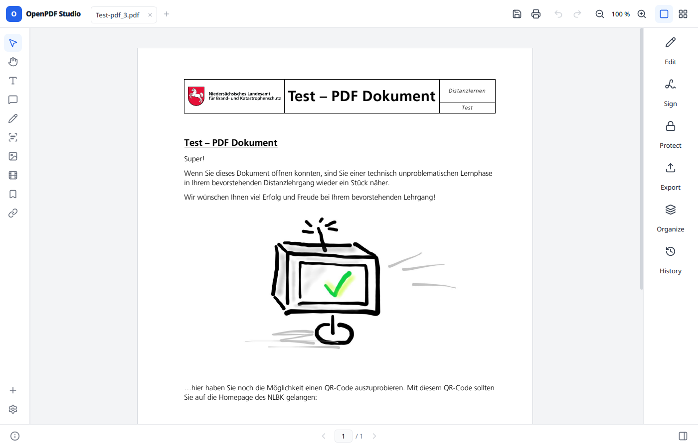

# OpenPDF Studio architecture

[README](../../README.md) · [Developer documentation](../../README.md#developer-documentation)

How the parts of the program work together. See [Contributing](../../CONTRIBUTING.md)
for the layer rules, [Building](building.md) for build commands and
[PDF engine](pdf-engine.md) for the PDFium boundary.

## Startup

`main.cpp` applies theme and language from `config.ini` and, with debug
logging on, has `app/LogFile` copy Qt's messages into `openpdf-studio.log`
beside it (on Windows it first
makes the main thread an OLE apartment, which Explorer drops need), then hands the
arguments to `Cli::run()`. A recognised command runs without a window and
exits. Otherwise `App` builds the `MainWindow`, opens a file named on the
command line, and `MainWindow::restoreSession()` offers what a crashed run
left behind. After the license usage question, `MainWindow::offerDefaultPdfApp()`
asks once whether the program should become the default for PDF files;
`DefaultPdfApp` in `app/` asks `xdg-mime` or the Windows association. Started
with `--render-server`, the program is a render helper of a running window (see
`RenderPool`) and does nothing else.

## Main window

`MainWindow` owns the frame: `TopToolbar`, `FormatBar`, `DrawBar`,
`LeftSidebar`, `BookmarkPanel`, the tool panels, `RightSidebar` and
`StatusBar`. Every tab is one `DocumentView` in a `QStackedWidget`.
An elevated window gets no OLE drops from Explorer, so there `ShellFileDrop`
takes the shell's `WM_DROPFILES` and hands them on as an ordinary Qt drop.

The window only forwards. Bars and panels act on the current `DocumentView`,
and the view's signals update bars and panels. Work that runs through a dialog
lives in its task folder: `Exporting` and `Printing` in `ui/export/`,
`Importing` in `ui/import/`,
`HistoryDialog::openFor()` in `ui/history/`, `DigitalSigning` in `ui/sign/`,
`ProtectDialog::run()` in `ui/protect/`. Before printing, copying, editing,
commenting, organizing, exporting, signing or changing the protection, the
window asks `PermissionGate` in `ui/protect/`, which checks the reader
permissions PDFium reports and lifts them for the view with the permissions
password, unless Settings > Security switches that off.

*`LeftSidebar` is on the left, `RightSidebar` on the right and `DocumentView` in
the centre. The top and bottom frame belong to the main window.*

## One open document

`DocumentView` coordinates one document. The state sits in these parts:

| part | holds |
| --- | --- |
| `DocumentSource` (`engine/document/`) | the `PdfBackend`, the `PdfRenderer`, the `ContentProvider` and the `DocumentWorker` for the file currently loaded |
| `EditSession` (`engine/edit/`) | pending text, image and annotation edits |
| `DocumentJournal` (`engine/historymanager/`) | change log, unsaved state, save target and restore |
| `EditController` (`ui/edit/`) | the one edit open in the inline editor |
| controllers in `ui/view/` | page layout, zoom, find, text selection, hover |
| layers in `ui/view/`, `ui/notes/`, `ui/draw/` | images, links, notes, drawings, signatures |
| `PageOverlay`s from modules | whatever a module lays over the pages |

## Backend and edits

`PdfBackend` is the interface and `PdfiumBackend` its only implementation.
`PdfBackend::renderPage(page, scale, session)` draws a page with the session's
edits applied by `PdfiumEdits::applyToPage()`, which swaps text objects in the
page's object list in memory. PDFium only writes that list back on
`FPDFPage_GenerateContent()`, so `PdfiumWriter` runs the same function when
saving, and the screen shows exactly what the file will contain.

Everything above the engine works in points of the page as shown: top-left
origin, cropped by the CropBox and turned by /Rotate. `PdfiumPageSpace`
converts to and from PDF user space wherever the engine reads or writes
coordinates.

`PdfiumText::Typeset` sets the text of one edit. Every character keeps the
style of the original character it came from (font, size, matrix, colours,
render mode, letter spacing, baseline shift); `TextLayout::styleIndices()`
finds that character by comparing the text with the original lines, and a
typed character takes the style before it. The colour keeps its opacity, so
text set gray as black under one shows gray in the editor too. The format bar shows the style of
the character clicked or at the caret (`Metrics::appearances`). A change from
it replaces one attribute for all characters and keeps the others; a size is
the shown character's and the others scale with it. With part of the text
selected it goes for those characters alone (`Edit::marks`, one
`TextLayout::Mark` per character): `Typeset` gives each style a marked
character has a counterpart with the mark on it. A character the style's font cannot encode is written in the same
family from the system, else in an embedded font of the same kind
(`PdfiumFonts::fallbackFont()`). Pasted text names, per character, a character
of the document it was copied from (`SourcedText`, `Edit::sources`) and is set
in that one's style. Copied text carries where each of its characters is set
(`SourcedText::Box`): a box copied whole relative to the box, marked text or a
selection on one page relative to the characters taken; pasted on the page
outside a box it becomes a laid box there, every character in the same place
(`EditController::pasteBox()`). The text is written in runs of one style with
the exact glyph positions. The inline editor gets its glyph widths from the
same code (`PdfBackend::editMetrics()`) and lays text out with the same
`TextLayout`, so lines, list markers and positions in the editor are the ones
written; soft line breaks travel in the text as U+2028. An edit whose style and
box layout are unchanged is laid out anchored to the original lines
(`PdfBackend::originalLines()`); while its box has not moved, unchanged lines
stay the original PDF objects and changed lines keep their text up to the
first change in place. Whether an original object stays is decided by its
characters, the same way the layout keeps them. A justified box spreads each
line's room over its spaces in the same layout, so editor and file agree.
Text turned by whole quarter turns, by its matrix or by /Rotate, is read in its
own direction and opened as a box turned by `TextBoxProperties::rotationDeg`.
It is typed in an upright window beside it (`EditOpener::windowSpot()`): the
window is the box in a frame turned back about a pivot. The preview draws the
box turned in place (`EditSession::turnAbout()`), which is also what closing
writes; `EditCallout` draws the window's text (`renderEditText()`) on white
over the page, so the page's marks and notes stay under it.
`TurnedFrame` draws the window's frame turned on the text and passes the
pointer to the window turned back, so moving and resizing it there work as on
upright text: the pivot stays put during such a drag and the window is hidden,
then `EditController::keepWindowOnPage()` puts it back at its old distance to
the text. `EditController::takeBounds()` moves the pivot when the window alone
moves (dragged, zoomed), so the text stays; the card also carries the arrow
to it and the angle. Its original objects are always set anew, never kept.
PDFium's page writer is lossy: it drops Type3 text, character and word
spacing, soft masks and every colour that is not DeviceRGB. So the page's own
content is not taken from PDFium. `OriginalContent` (qpdf) counts the page's
objects the way PDFium parses them; when the counts agree and the edits only
took text out, it writes the original content back byte for byte without the
replaced text shows, inside `q`/`Q` so nothing it leaves set reaches the new
text, and appends PDFium's stream with the new objects. Pages
where that does not hold (link styling and changes to the page's own images
alter objects in place) keep PDFium's
regenerated content, with colours pinned to RGB and Type3 or spaced text put
back from the original operators by `KeptText`. PDFium tells fonts apart by
name, so fonts the editor embeds carry a subset prefix in their name that
differs from run to run, and text is never set again in a document font whose
name another font on the page shares.
The page's own images are changed in place by `PdfiumImages`, found by their
position among the untouched page's objects; one inside a form takes the
form apart on that page only, as PDFium cannot rewrite a form's content.

## Rendering

### Where renders run

PDFium is not thread-safe and renders one page at a time per process. Every
call into it holds `PdfiumLock`; the GUI thread always gets the lock next, and
a background render pauses at the next point PDFium allows when it waits.

`PageLayoutEngine` plans what to render and hands it to the document's
`DocumentWorker`, a background thread. For an expensive document (a file of
32 MB or more, or two renders over 120 ms) the worker also gets `RenderPool`
(`engine/document/`): helper processes, the program itself started with
`--render-server` (`RenderServer`), each with its own PDFium and the file open.
They render unedited pages in parallel and send them back over a local socket.
Pages with edits, the search, links, notes and saving stay on the worker
thread. Before the file may be replaced, the helpers close it
(`DocumentWorker::stop()`).

The program adapts to the machine:

| situation | what happens |
| --- | --- |
| small document | no helpers; the worker renders everything |
| 1 to 3 cores | no helpers |
| more cores | half of them less one as helpers, at most 6 |
| little free memory | fewer helpers, about 400 MB free each |
| helpers do not start | the worker renders everything |
| 1 or 2 cores | only the nearest zoom levels are prepared |

The worker thread and the helpers run at a lower priority than the window, so
on few cores the window gets the processor first and pages arrive in the
pauses. Page renders and kept tiles share a quarter of the free memory,
between 192 MB and 2 GB (`app/SystemMemory`); prepared zoom levels get a quarter of
that again.

### Pages and tiles

The worker renders the visible pages first, nearest the middle of the view.
Pages are `PageView`s, which draw their picture as it is; a QLabel would
rescale it on every paint. A small preview of each page stands in while the
page is rendered again. A page larger than about four million device pixels
at the current zoom gets a render capped at eight million and, from
`PageTiles`, sharp tiles of 512 device pixels in a fixed grid over its visible
part. While a visible page shows nothing yet, `LoadingSpinner` turns over the
document.

Background renders keep their last pages loaded, so the tiles of a page share
its decoded images; an edited page is kept with its edits for as long as its
version stays the same. PDFium reads an image the coarser the smaller the
bitmap it renders into, a JPEG down to an eighth, whatever part of the page
that bitmap shows. Every part of a page is therefore rendered into a bitmap
sized by `PdfiumPart`, in which each image comes out as for the whole page.

What was on screen once comes back without a render. Tiles that leave the view
are kept and put back in the same frame when the view returns. A picture
already shown is never replaced by a second render of the same state; only the
exact render after editing replaces it.

### Zoom and scrolling

While nothing else waits, what a zoom about the pointer would show is rendered
for the wheel steps ahead (`PageLayoutEngine_Zoom.cpp`): up to twenty in and
ten out, one step in either direction for any point in view. `ZoomController`
applies a wheel or keyboard zoom one step at a time. A step waits at most
60 ms for its prepared picture, which then becomes the page's tiles or render
at that zoom without a copy; otherwise the step is shown at once and sharpened
when its render arrives. A zoom seen before comes back from the kept tiles or
from the page's earlier whole render. In edit mode only the nearest steps are
prepared.

A mouse wheel step glides instead of jumping (`SmoothScroll`), driven by the
window's frames; touchpad gestures are left as they are.

The grid of thumbnails and the find bar use the worker too: thumbnails in view
first, the search page by page with matches shown as they come in. A page
without a text layer is rendered at 300 dpi and handed to `OcrSearch`
(`engine/ocr/`), which reads it on up to three low-priority threads.
`PdfiumScanText` sets what was read as invisible text of a document kept in
memory until the file is closed, so PDFium's own search finds it by the rules
it uses for text; each match is shown on the boxes of the scanned letters. The
text is set on the main thread, since the fonts of that document must outlive
the reader. The find bar sorts the late matches in by page, and its progress
bar counts a page being read by how far OCR got (`DocumentWorker::scanProgress`).
The page organizer opens its files again as `OrganizerDoc`s, each with its own
worker, and loads its thumbnails the same way (`ui/organizer/OrganizerThumbnails`).

### Editing

While text is edited, only what differs from the unedited page is rendered
again: `PdfBackend::renderChanges()` compares the page objects before and after
the edits and renders that area, which is patched into the page
(`PageLayoutEngine_Edit.cpp`). PDFium rounds text by where a render starts, so
the last exact state of the area is rendered alongside and its pixels stay
wherever the change does not reach; the worker renders the page exactly once
editing pauses. Light pages are simply rendered whole. A page that is slow to
render (a large picture, thousands of paths) is not patched at all: the worker
renders it once without the edit's text, under a version number of its own
because the worker keeps one loaded page per number, and then, for every key or step of a
drag, only that text on transparency (`PdfBackend::renderEditText()`), which
the window lays over it. The window never waits for PDFium; the laid text
differs from an exact render by at most two colour levels at glyph edges, and
the page is rendered exactly when the edit closes. A tiled page has the worker
render each new state, a newer one waiting for the render on its way instead
of cancelling it. A box being moved carries its text as a picture: the worker
renders the text alone and the strip under it without it once, the strip
replaces the text on screen and the picture follows the frame
(`PageLayoutEngine_Drag.cpp`). While text is edited no
zoom levels are prepared, so the worker stays free for the edit. After a zoom
the page being edited is rendered on the worker like any other; the area its
edits change is kept in points, so typing goes on patching at the new zoom.
`PdfiumBackend::editMetrics()` measures the usual characters along with the
text and keeps its recent results regardless of the text; the editor takes
sizes and widths per text from them and asks again only for a character they
lack.

## Annotations and content

Links and notes are read by `AnnotationLoader`: as much as fits 50 ms when the
document opens, the rest page by page on the worker. Any change to a link or
note first reads the remaining pages, so undo always sees the whole list.

A note linked to text is a highlight annotation. New links are drawn by
`NoteLayer` over the page; ones already in the file are drawn by the page,
so a removed one is hidden in the open document while rendering
(`PdfiumEdits::showNoteHighlights`) and its page counts as edited.

`ContentProvider` (`engine/edit/ContentModel.hpp`) finds text lines,
paragraphs, table cells, form fields and images on a page. Hover only reads
its cache, because building a page synchronously stalls scrolling.
`ContentMap` chains the lines below each other per column, cell or centred
block and ends a paragraph where the spacing grows, where the next line's
first word would have fit, at a justified line short of the margin, an
indent, a list marker or a heading. Columns and cells are told apart by the
white channel running down between them (`TextGutters`), which the line
reader in `PdfiumBackend` uses as well, so a click opens the same lines both
see. A scan
that OCR has read is read as that text by the line reader and by the content
detection, as if it had an invisible OCR layer; a click on an unread scan waits
for the worker to read it (`DocumentWorker::readScan()`), which the text tool
already asks for the page in view and its neighbours. Text that shows
only as a scan's pixels, found by OCR or in an invisible OCR text layer
(`PdfBackend::hiddenText()`), is an `Edit::scanned`, as is every line of a
page this program read that holds no text of its own: `ScanFont` finds the
installed face, weight, size and baseline its pixels match by rendering the
candidates over them (`ScanFit`), a paragraph keeps only the lines set alike, the colour is
sampled, and nothing of the invisible layer's font is used. A line's weight is
the one most of its words fit, its size the one most of their width agrees on;
a word OCR read as two counts as the one it is (`ScanLine`). A line no weight
covers was misread, and how high its letters stand tells its size.
Where a line's own pixels cannot tell (faces left close, none covering well, too
few or too small letters), the lines nearby choose the face, and an unclear
weight is the one that gives the line their size; a line nearby that none of
the line's best faces covers was misread and has no say. Figures look alike in
most faces: a few of them are compared in every face, on their row and the rows
of figures nearby, each face counting for less the farther its strokes are from
holding the scan's ink (a face's ink counted as the scan's is, blurred and
against its own darkest, so thin strokes count as thin), also a face the
document showed before. A heading of a word or two
is bold where it holds more ink against the regular face than the lines nearby
hold against theirs, and a few figures found bold are regular where they hold no more.
Letters set apart or read one by one tell their size by their height, the
face's letters blurred and cut as the scan's ink is (`ScanFit::fitLine`),
figures and capitals letter by letter, so a row lying a little askew is no
higher; the blur of a few figures is told by how soft their strokes show
(`ScanFit::blurOf`), and rows nearby printed about as large share one size.
Ink tells against a face only where the face is clearly heavier than the scan,
as print and scan only add to a stroke.
An edit changes a scan only in the scan's own pixels (`PdfiumScanInk`, with the
pixel work in `ScanPaper`). The page is read whole once at the scan's
resolution and every piece is cut from that (`PdfiumScanInk::Cache`), in the
view and in a save alike. Whole words that keep their text and look stay as
they are where they stand (`Typeset::keptOnScan`), and those an edit only
pushes along their line go there as the pixels they are, by whole pixels of
the scan (`Typeset::movedOnScan`), so no font, misreading or weight of the
matched face shows on a word nobody typed. What an edit replaces is cleared of
its ink word by word, each word parted from the next in the white between
them: the block around a word's ink takes the tone of the paper around it and
its grain in blocks of that paper (`ScanPaper::withoutInk`). What it sets
is drawn from its glyph outlines at the scan's resolution and laid on the page
as pixels, thickened, blurred and faded as the scan printed its own words,
or cut to black and white on such a scan: a few of the scan's words, drawn in
the matched face where the scan has them, are held against their pixels to
find that look (`ScanPaper::printedLike`), in the colour the text is given.
The text itself is written word by word without showing, as an
OCR layer holds it, where the page has such a layer; a scan without one stays
without and is read by OCR again when the file is opened. The pixels read and
the look found are kept by the backend while the document is open
(`PdfiumScanInk::Cache`), so typing reads them once. Preview and file take the
same way; where the preview lays the text over the page, the page keeps the
scan and the text brings these pixels. Each line is set where the scan has it, on its
own baseline with each word on the middle of its ink (`Edit::originalLines`),
so indents, centred and justified lines and tab stops keep their places; an edit
closes up on what it replaced where the scan had it, and a gap as wide as a tab
stop takes up what it grew or shrank. A scanned paragraph flows as in a text editor
(`ScanFlow`): the lines of the text are matched to the scan's lines by what
they hold, not by their number, so a line broken with Enter, joined or deleted
moves the lines below by a line. Where the scan's paragraph flowed over a
line's end, a line grown too long passes its last words to the next, one with
room takes the next line's first word, and a justified line is spread to the
right edge again; a line of few words, as of an address, is a line of its own.
Words that keep their text go to their new line as the scan's pixels, as their
ink alone (`ScanPaper::inkAlone`), so they stand on the paper where they land.
Nothing the user did not type is set in the matched face, whatever OCR read:
the letters an edit leaves alone are taken as runs that follow each other as
the scan has them (`Typeset::scanRuns`), each staying where it is or going
where the layout puts it as the scan's pixels, also inside a word the edit
changes and where a paragraph breaks anew (`ScanFlow` keeps the scan's steps
between such letters, and a letter typed for one of the scan's takes that letter's room). A run is cut from its word in the white between two
letters; the cuts of one word are settled together on its runs of ink
(`ScanPaper::inkRuns`, in `PdfiumScanInk`), so what lies between two cuts is
as many letters as the text has there and no letter is cut or lost; where two
letters touch at a cut it goes outward to the next white and what it passes is
typed anew. Letters
that stand apart, as figures in a form, are set each on its own ink
(`EditOpener::settleScanLetters`), and letters printed apart keep their
spacing in their places and still anchor. A line read across a gap far wider
than its letters' steps is two entries side by side, of which the clicked one
is taken (`ScanCleanup::keepSide`). Letters printed apart, which OCR reads
badly or in pieces, are read again set close as a word, as far as they stand a
like step apart (a word's last or first letter beside them is none of them),
and the lines of a form around them leave the sample every
later measurement reads (`EditOpener::rereadSpaced`, `EditOpen::wipe`). The page's
reading is followed by one of rows of letters far apart that it left out or read in pieces, each letter set
where the scan has it (`OcrMissed`, `OcrEngine::readMissedRows`), and a row of figures each apart with a
letter among them, as OCR reads from a smudge, opens as the run of figures clicked
(`EditOpener::keepFigures`). A small opaque picture without ink that lies over a scan and under nothing
else, as an earlier edit leaves where it cleared a word, is no text: the page is read without it and the
sample an edit measures in loses it (`PdfBackend::scanPatches`, `EditOpen::dropPatches`). A stroke
drawn by hand, coloured among dark print or one long thin curve, is no text either: reading and sample
lose it the same way (`ScanPen`). Letters with white between each are one word with a letter spacing
(`EditOpener::closeApart`), each on its own run of ink, also in groups or with a place left empty
(`ScanCleanup` lettersApart), and what is typed behind such a row stands that spacing off. Such a row is
one step from middle to middle: a typed letter stands in the middle of its place whatever its width
(`Line::pitch` in `TextLayout::anchorLine`). Its letters may stand higher than the usual one with their
foot on the row's line or their head at the row's, as capitals, ascenders, descenders and dots do; a
smudge reaches above and below (`lettersHigh`). A figure or letter typed among letters set apart is the
scan's own ink of that character again, in whatever face the scan is: from the edit's own lines where
they show it (`Typeset::copyFigures`), else borrowed from the nearest piece of ink on the page that is as
large and shows that character before every other (`PdfiumScanInk` borrowed, `ScanLike`); else it is set
in the matched face. Small pictures an earlier edit laid over the scan are known (`PdfBackend::scanPictures`):
one without paper under its print is a smudge and no text, and one with print neither gives the line's
size (`Scan::foreign`) nor is taken for a typed character before the scan's own print. The letter spacing of a scan's text can be changed
like any other: the edit keeps the spacing its lines opened with (`Edit::scanSpacingPt`), and each of
the scan's letters stands as much further on as the box's spacing differs from it (`Params::scanWiderPt`
in `TextLayout::anchorLine` and `ScanFlow`), a paragraph flowing anew; letters that touch go together
(`Typeset::joinTouching`). What is done to the box leaves the scan's letters the scan's own ink. Lines fitted
to that ink are marked (`Edit::scanFitted`), as the box's place no longer tells them once it is moved. A box moved
takes them along (`Typeset::scanShift`; on a scan lying askew they turn about where the box stood,
`Typeset::turnOnScan`). A frame around all the ink of what a click opens takes it as that click does
(`EditOpener::framesWholeScanUnit`), and one around whole lines of it takes those lines the same way while the
lines beside them stay the scan's (`EditOpener::framesScanLines`); one around several such units, as a label and the entry far behind it, takes them as one line with the scan's gaps (`EditOpener::framesScanUnits`); a part cut out of a line by a frame is set anew, as its places are only read. Set larger or smaller they are that ink as large, and a paragraph flows anew on the
scan's lines as large (`Params::scanScale` in `ScanFlow`). Coloured or shown through they are that ink in the
colour (`ScanPaper::tinted`), and an underline is printed under them. A line or paragraph spacing moves their
lines, and an inset grows the box around them. Another face, bold, italic or a box turned further than a scan
lies askew sets them anew. The picture carried while a box is dragged holds these letters too
(`Typeset::liftFromScan`). Only
the clicked line is looked at where the click was, and only beside a label, on
a rule read as a line or on letters OCR did not read: a click on the paper near
a line of text opens that line. The
rules of a form are no text. One finder knows them, drawn through, dotted or
dashed, also a little askew: a thin stretch of ink with paper on both sides,
an upright one where it runs from one line across to another, those lines
no ink beside it (`ScanRules::find`). OCR reads the page without them, found
once it is straightened, where they run level and whole
(`OcrEngine::setPage`); a rule still read as a line of words opens as no text
(`EditOpen::ruleAlone`). The sample an edit measures in loses them as soon as it
is rendered (`EditOpen::dropRules`), where they lay still parts two lines into
two edits (`ruledBetween`), and a rule running through a word's area is neither
cleared nor moved with it (`PdfiumScanInk` rulesAround, `ScanPaper`). A scan
another program read, all its text invisible over the page's picture, or one
with a little text set onto it, as a stamp, is read again by this program's
OCR for editing (`PdfBackend::scanBelowText`): such a layer may miss whole
tables, and the stamp tells nothing of the scan. What is typed is drawn as thick and as blurred as brings the
face's strokes to the scan's darkness at the scan's ink, at their darkest, their middle and near their edge,
the face's own strokes before thinned or thickened ones (`ScanPaper::kGainsPx`), and never much lighter or
darker than the scan's own. A family installed as a Type 1 file and as an OpenType one is taken as the one
that can be embedded, and a face that cannot be loaded gives its outlines through PDFium
(`PdfiumFonts::glyphOutline`), so text typed on a scan always shows as pixels.
A scan lying askew is laid out level in a box turned by its slope; the box keeps
what it turns about while it grows (`EditTarget::turnPivot`, applied with
`EditSession::turnAbout`), so its words stay on the scan's. Lines
set flush right or centred, told by their own edges or by those they share
with the page's lines, grow that way in a box that holds the room beside them
(`EditOpener::alignScan`); a line with ink close before it on its rows is the end of something longer,
grows to the right and tells the lines around it no edge. A line of its own has room up to where the page's
text ends on the right or other text stands beside it (`EditTarget::roomRight`,
which stops the frame's growth there and goes with the text wherever its box is moved), a short entry alone on towards the
page's edge; out of room it breaks and goes on a line below, as the scan's
pixels too. Lines an earlier edit took still tell where the page's text ends.
A box made narrower than the scan has its lines holds them all, single lines
and paragraphs, and they break at its edge as in any text box (`ScanFlow`). A number and a word OCR read as one are parted where the
line shows a word's gap more than its text has spaces
(`ScanCleanup::partFigures`). A click puts the caret where the text was
clicked. Columns OCR read as one line are parted
at the white channel between them, where words start alike in the rows around,
and a click opens its column only, looked at on the lines no rule parts from
the clicked one; letters set apart at a like step are one entry and no columns; there a wide gap between words read by OCR
parts blocks only where it stands out from the other gaps of its column or
from the gaps beside it, so a loosely justified line opens whole and a table's
cells stay apart. In a fixed pitch face, where words start below each other
all over the lines, a channel parts columns only where it is wider than the
gaps between the words as well (`ScanCleanup::keepColumn`). Each word of the app's own OCR layer counts as a word of its
own, though the layer holds a line in one object, and an OCR layer over a page
lying askew is grouped into lines and paragraphs turned level by the page's
slope, its margins with its lines (`PdfiumContentProvider::collectWords`). A line printed italic is
set italic, and a word printed bold or italic in a line set otherwise keeps
its style as a mark of the edit, told by its ink and its shape. A page
lying askew by up to 3° is set level in a box turned with it, and the cover
follows the slope piece by piece; an OCR layer's slope is taken from each
word's matrix, as PDFium's character angle leans with how far a word is squeezed. Bullets, middle dots and dashes OCR misread
are told by the shape of their ink. Where the detection is wrong, a frame drawn with Shift
decides instead: `EditOpener` takes exactly the characters inside it, also
part of a text object, and `PdfiumEdits` splits such an object when the text is
taken out, setting the characters outside the frame again where they were. On
text edited or moved before it takes the characters where they are set now
(`PdfBackend::editLines()`); the rest of that box becomes a box of its own, each
character in place and in its style (`Edit::laid`). When the frame closes,
its edit goes back into what a click there opens, the paragraph or the box
(`EditController::mergedFrameEdit()`): spaces fill what the framed text no
longer covers, so the text stays one piece.

## Changes and saving

The file on disk is only read until the user saves. Every change goes into the
journal: undo stack, change log, and snapshots in the session folder.

`DocumentView::saveToFile()` works in this order:

1. If the target is the file currently loaded, the view first moves onto a
   working copy (`detachSourceFrom()`), so PDFium never reads a file that is
   being replaced.
2. `stageDocument()` writes the backend's edits, then each overlay's
   `PageOverlay::writeTo()`, then changed bookmarks into a staging file. The
   edits are written by the worker while a local event loop keeps the
   spinner turning; user input waits until the file is written.
3. A protection set in `ProtectDialog` is written by `ProtectionWriter`:
   new encryption and permissions, or none. Until then it waits in
   `ProtectionLayer`, an overlay, so history, undo and recovery carry it like
   any other change. Its passwords stay in memory only; after a crash the
   change comes back as "unprotected".
4. Pending digital signatures are signed into the staging file. A save with
   no edits on top of the content file (only signing, a removed signature,
   nothing at all) copies its bytes unchanged, and so does a history snapshot,
   so signatures already in the file stay valid. In an encrypted file the
   update is encrypted with the file's own key, under the password it has
   after step 3.
5. `SafeWrite::commit()` replaces the target. If that fails, the target is
   untouched.
6. The view reopens the saved file.

## Writing guard

No PDF is written past the history manager. Every writer takes a
`WriteGrant`; only `DocumentView` (staging, recovery copies, working copies),
`Exporting`, `Importing` and the command line issue them, and `cmake/CheckWritePaths.cmake` fails the build when a file outside
its list uses a low-level writer or issues a grant. Scratch grants name files
nobody chose and are never opened as documents.

Before anything is staged, `WriteGate::recorded()` compares the document's
state with the history's current entry; a difference means a change went past
the journal, and nothing is written. Staging ends with
`PdfConformance::raiseVersion()`, which lifts the header to what the features
need (soft masks 1.4, optional content 1.5, rich media 1.7 extension level 3).
Before the target is replaced, `WriteGate::sound()` checks the file: page tree,
media boxes, resources named by content streams and appearance streams,
annotations, decodable objects and the version. Only problems the opened file
did not have already stop the save. Test and debug builds abort instead
(`OPENPDF_STRICT=1` in release builds).

The organizer writes only into a working copy from
`DocumentView::newWorkingCopy()`, which `openWorkingCopy()` takes into the
history; its Save As then saves the document like any other save.

## Redacting

The Redact tool (`ui/redact/`) keeps its marked areas in `RedactionLayer`, an
overlay: every area added, moved, resized or removed is a journal entry and
part of the state history, undo and recovery restore. The areas are carried out
in `RedactionLayer::writeTo()`, the last overlay step of staging, so saving,
recovery copies, exports and prints all hold the redacted document; after a
save the view reloads the file like after signing. `RedactionWriter`
(`engine/redact/`) works on the staging file:

1. `PdfiumWriter::rewrite()` runs `PdfiumRedaction::apply()` on each marked
   page in the same pass saving uses, so the original content is kept where
   only text was taken out. Characters touching an area leave their text
   objects and the rest is set again (`PdfiumTextCut`, shared with the Text
   tool); image pixels under it turn black; paths keep what lies outside, a
   stroke as its outline; annotations over it go. Anything else under an area,
   such as a form XObject or transparency, makes the page an image.
2. qpdf builds a new file from the pages alone and drops unused resources, so
   nothing of the removed content stays reachable. Image pages are replaced
   there.
3. `PdfiumRedaction::leaks()` checks every area for text, image pixels, paths
   and the bar. A failing page is made an image and the copy checked again;
   if that fails too, the save fails.

## Forms

`FormLayer` (`ui/forms/`) is an overlay. Its state holds the values filled in
and the designed fields (`FormSpec`, `engine/forms/`), so both are journal
entries that undo, history and recovery restore. It reads the fields from the
file page by page and puts boxes over them; with Select, Pan or Bookmark a
click fills a field in. Formats, ranges and calculations come from the
standard Acrobat functions in the field scripts (`FormScript`), since PDFium
runs no JavaScript. A simple `event.value = ...` with `getField()` is
calculated too, anything else is left alone.

A text field is typed into in a transparent editor over its box.
`FormTextLayout` (`engine/forms/`) repeats PDFium's layout of the field -
automatic font size, line breaks, baselines, alignment, Helvetica's widths -
and `FormEditLayout` sets the editor's lines by it, so the text stands while
it is typed where the render will draw it.

The Form fields tool (edit mode, `FormDesigner`, `FormFieldPanel`) draws new
fields and moves, resizes, renames and removes fields of the file.

The layer hands both to the edit session. `FormFieldWriter` (qpdf) builds
the file with its fields as designed in memory; `PdfiumForms` fills the values
in through a PDFium form environment, which also makes the appearances. The
preview renders a page with form changes from this second document
(`PdfiumBackend::renderFormPage()`), and `PdfiumWriter::save()` starts from
the same memory document, so the preview is the file.

PDFium draws form fields only through a form environment
(`FPDF_FFLDraw()`); `PdfiumBackend` keeps one for every document with an
AcroForm and draws it after each render.

## Crash recovery

`SessionStore` (`app/`) keeps working copies, snapshots and a list of the open
documents. `SessionRecovery` (`ui/session/`) watches every view and writes a
history archive half a second after each change, and a recovery copy on the
view's worker every half minute at most. An edit open in its editor is out of
the session until it is taken again; the copy holds it as the history does. Every history entry keeps, besides
images, bookmarks and overlays, what the undo stack holds: text edits, notes,
links, drawings and changes to the page's own images (`DocumentState::edits`).
At the next start the document is taken up on its base file with the last
entry's state, and the undo stack is rebuilt from the entries
(`DocumentView::resumeTimeline()`), so the steps before the crash can be undone;
an archive without those states falls back to the recovery copy. `App` removes snapshots older than seven days
on startup.

## Import, export, OCR and signing

- **Import** (`engine/import/`): docx, odt and images become a PDF working
  copy before opening, on a worker thread (`Importing`). The copy has no save
  target, so saving asks for a name.
- **Export** (`engine/export/`): PDF with page selection through qpdf, DOCX
  and ODT with layout detection, PNG, JPEG, TIFF or WebP per page, plain
  text from each page's text layer, Markdown and HTML (`MarkupExporter`, from
  the same `DocxPage` content as DOCX turned into `MarkupPieces`, as flowing
  text; `DocxPage::links` brings the page's web links along and
  `DocxBlock::withLabels` a chart as the page shows it), and printing. ODT takes
  the same page content as DOCX (`DocxPage`) and writes it with `OdtExporter`.
  A line's changes of font, size and colour travel as `ContentItem::runs`. `Exporting` and
  `Printing` read an `ExportCopy`, written by `writeRecoveryCopy()`, so unsaved
  changes are exported and printed like a save would write them; the formats
  run on a worker thread.
  PDF/A-2b (`PdfA`) converts the qpdf document `exportPdf` built before it is
  written: XMP metadata, sRGB output intent, forbidden actions and annotations
  out, missing appearances drawn (`PdfAAppearances`), and fonts the content
  shows without a program embedded from an installed font with the same widths
  (`PdfAContent` finds them, `PdfAFonts` embeds a subset). `PdfAGlyphs` checks
  the fonts already embedded against their programs (`FontProgram` reads
  TrueType, CFF and Type1): a glyph for every character shown and the same
  widths; a missing Type3 glyph becomes an empty one. What it cannot fix, CMYK
  colour among it, stops the export. The written file is converted once
  more; anything left to do discards it.
  `PrintSheets` lays the pages out on sheets, for the preview
  in `PrintDialog` and for the printer alike. DOCX pictures are compressed page by page while the content
  is collected, so long documents never hold their rasters all at once.
- **OCR** (`engine/ocr/`): Tesseract, for text the page has no text layer for.
  It loads the offered languages that are installed (`OcrLanguages`) and
  reloads when that set changes; a scan clicked without any shows `EditNotice`
  with a way to the add-on page. A page is binarized with Sauvola and
  straightened before reading; the boxes found are turned back onto the page.
  Words read as one are parted where the gap between two letters is as wide as a space,
  and a line read over columns where its words stand two and a half line heights apart.
  For the search and the editor `OcrStyle` then sets each word in the face its paragraph is
  printed in (`ScanFont`) and tries the readings OCR confuses (a dash and a
  hyphen, § and 8, O and ©, o and 0, a missing accent or abbreviation point);
  one replaces OCR's only where the scan sides with it on most of the pixels
  the two differ in, and the letter boxes come from that setting.

## Add-on packages

On Linux, Settings > Add-on Packages (`ui/settings/SettingsPanel_AddOns.cpp`)
installs and removes OCR languages and, from the module, ffmpeg with the
distribution's package manager: `app/SystemPackages` picks the names for
Fedora, Debian or Arch and runs dnf, apt-get or pacman through `pkexec`, so
the system asks for the password every time. Before a removal it asks the
package manager what would go along (`dnf remove --assumeno`, `apt-get -s
remove`, `pacman -Rcp`) and names that in a question. Without `pkexec` the card
shows the command.
Fonts are left to the desktop's font management, which the page only opens.

On Windows the page downloads instead (`ui/settings/DownloadControl`,
`app/FileDownload`, which keeps a file only when its SHA-256 matches): OCR
languages from `tessdata_fast` 4.1.0 into a folder of the user's own, which
first takes a copy of the bundled ones because Tesseract reads one folder, and
ffmpeg as Gyan's 7.1.1 build, the one ffmpeg.org points to for Windows: a ZIP
whose `ffmpeg.exe` Windows' own `tar.exe` takes out, with both checksums
pinned. That build is GPL with Media Foundation; the user fetches it, the
packages never carry it. Removing the shipped `ffmpeg.exe` under
Program Files goes through `app/Elevation`, which starts the program once more
behind the UAC prompt with `--remove-app-file`. The installer offers ffmpeg as
a component (`/NOFFMPEG` for silent installs); the uninstaller removes the
downloaded add-ons too unless that component is unticked (`/KEEPADDONS`). On other systems the page is
absent.
`AddOns::open()` leads there from a message that names something missing.
- **Signing** (`engine/sign/`, `ui/sign/`): a handwritten signature is placed
  as an image. A digital signature waits in `DigitalSignatureLayer` and is
  written on save by `PdfSignatureWriter` as an incremental update.
  Certificates come from PKCS#11 through p11-kit or PEM files on Linux, and
  from the certificate store through CNG on Windows. `SignatureManager::verify()`
  checks existing signatures. A signer the system does not trust counts as
  trusted when the certificate is one of the user's own or its SHA-256
  fingerprint is pinned in `app/TrustedSigners`; `ui/sign/SignerTrust` asks
  before pinning and lists the pinned signers (sign page, Advanced), where a
  certificate file can be added too. `SignatureRemover` takes one off, with everything
  added after it, by cutting the file back to the revision before it; one
  without such a revision is cleared out of its own with qpdf, together with its
  field and stamp when `PdfSignatureWriter` made them. The view opens
  the result as a working copy.
- **Document information** (`engine/document/DocumentInfo`, `ui/info/`):
  `DocumentInfoLoader` reads version, encryption, permissions, form fields,
  attachments, PDF/A and verified signatures with qpdf on a
  background thread whenever a view opens or saves a file. The status bar shows
  signatures and encryption from it: its shield opens the card on the
  unfolded signatures, its lock the protect dialog. `InfoCenter` lists all of
  it; its Security section opens the protect dialog and each signature the
  dialog that removes it (`ui/sign/SignatureRemoval`), an untrusted one also
  the question that trusts its signer. A change to the trusted signers
  re-checks every open document. `SignatureVerifier` also reports the page and
  place of each signature, for its own stamps where the page content actually
  draws them (the stamp image names its signature in `/OPDFSignature`, so it is
  found after the image tool moved it), otherwise the field's `/Rect`; `ui/view/SignatureStatusLayer` puts a shield
  there that opens `ui/sign/SignatureStatusCard` with the result.

## Modules

`modules/rich-media/` plugs in through five registers the Core names nothing
media-related in: `LeftSidebar::registerTool()`, `ToolPanels::add()`,
`PageOverlays::add()`, `Importing::addFormat()` and `AddOns::addCard()`, all filled from one static
initializer in
`MediaModule.cpp`. A `PageOverlay` follows the document (`setDocument()`),
takes dropped files, writes itself on save (`writeTo()`), keeps its state for
history and recovery (`state()`, `restoreState()`) and reports changes to the
journal (`reportChange()`).

## Command line

`cli/` runs modes without a window on the same engine and views as the
application: `--export-pdf`, `--export-docx`, `--export-odt`, `--export-images`,
`--export-txt`, `--export-md`, `--export-html`, `--import-pdf`, `--organize-save`, `--select-text`, `--apply-edit` and the
`--shot-*` screenshots. They are the way to check a change without a display.

## Theme and language

`Theme::apply()` loads `Style.qss` or `Style.dark.qss`. Icons are SVGs tinted
at runtime by `Theme::renderSvg()` through nanosvg. Translations are the `.qm`
files in `resources/i18n/`; `MainWindow::applyLanguage()` swaps them at
runtime and calls `retranslateUi()` on the frame and every view.
