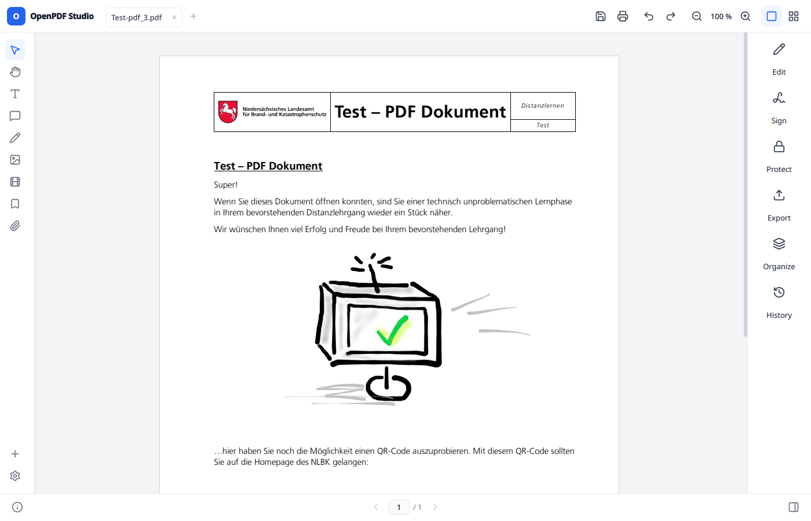

# OpenPDF Studio architecture

[README](../../README.md) · [Developer documentation](../../README.md#developer-documentation)

How the parts of the program work together. See [Contributing](../../CONTRIBUTING.md)
for the layer rules, [Building](building.md) for build commands and
[PDF engine](pdf-engine.md) for the PDFium boundary.

## Startup

`main.cpp` applies theme and language from `config.ini` and, with debug
logging on, has `app/LogFile` copy Qt's messages into `openpdf-studio.log`
beside it (on Windows it first
makes the main thread an OLE apartment, which Explorer drops need), then hands the
arguments to `Cli::run()`. A recognised command runs without a window and
exits. Otherwise `App` builds the `MainWindow`, opens a file named on the
command line, and `MainWindow::restoreSession()` offers what a crashed run
left behind. After the license usage question, `MainWindow::offerDefaultPdfApp()`
asks once whether the program should become the default for PDF files;
`DefaultPdfApp` in `app/` asks `xdg-mime` or the Windows association. Started
with `--render-server`, the program is a render helper of a running window (see
`RenderPool`) and does nothing else.

## Main window

`MainWindow` owns the frame: `TopToolbar`, `FormatBar`, `DrawBar`,
`LeftSidebar`, `BookmarkPanel`, the tool panels, `RightSidebar` and
`StatusBar`. Every tab is one `DocumentView` in a `QStackedWidget`.
An elevated window gets no OLE drops from Explorer, so there `ShellFileDrop`
takes the shell's `WM_DROPFILES` and hands them on as an ordinary Qt drop.

The window only forwards. Bars and panels act on the current `DocumentView`,
and the view's signals update bars and panels. Work that runs through a dialog
lives in its task folder: `Exporting` and `Printing` in `ui/export/`,
`Importing` in `ui/import/`,
`HistoryDialog::openFor()` in `ui/history/`, `DigitalSigning` in `ui/sign/`,
`ProtectDialog::run()` in `ui/protect/`. Before printing, copying, editing,
commenting, organizing, exporting, signing or changing the protection, the
window asks `PermissionGate` in `ui/protect/`, which checks the reader
permissions PDFium reports and lifts them for the view with the permissions
password, unless Settings > Security switches that off.

*`LeftSidebar` is on the left, `RightSidebar` on the right and `DocumentView` in
the centre. The top and bottom frame belong to the main window.*

## One open document

`DocumentView` coordinates one document. The state sits in these parts:

| part | holds |
| --- | --- |
| `DocumentSource` (`engine/document/`) | the `PdfBackend`, the `PdfRenderer`, the `ContentProvider` and the `DocumentWorker` for the file currently loaded |
| `EditSession` (`engine/edit/`) | pending text, image and annotation edits |
| `DocumentJournal` (`engine/historymanager/`) | change log, unsaved state, save target and restore |
| `EditController` (`ui/edit/`) | the one edit open in the inline editor |
| controllers in `ui/view/` | page layout, zoom, find, text selection, hover |
| layers in `ui/view/`, `ui/notes/`, `ui/draw/` | images, links, notes, drawings, signatures |
| `PageOverlay`s from modules | whatever a module lays over the pages |

## Backend and edits

`PdfBackend` is the interface and `PdfiumBackend` its only implementation.
`PdfBackend::renderPage(page, scale, session)` draws a page with the session's
edits applied by `PdfiumEdits::applyToPage()`, which swaps text objects in the
page's object list in memory. PDFium only writes that list back on
`FPDFPage_GenerateContent()`, so `PdfiumWriter` runs the same function when
saving, and the screen shows exactly what the file will contain.

Everything above the engine works in points of the page as shown: top-left
origin, cropped by the CropBox and turned by /Rotate. `PdfiumPageSpace`
converts to and from PDF user space wherever the engine reads or writes
coordinates.

`PdfiumText::Typeset` sets the text of one edit. Every character keeps the
style of the original character it came from (font, size, matrix, colours,
render mode, letter spacing, baseline shift); `TextLayout::styleIndices()`
finds that character by comparing the text with the original lines, and a
typed character takes the style before it. The format bar shows the style of
the character clicked or at the caret (`Metrics::appearances`). A change from
it replaces one attribute for all characters and keeps the others; a size is
the shown character's and the others scale with it. With part of the text
selected it goes for those characters alone (`Edit::marks`, one
`TextLayout::Mark` per character): `Typeset` gives each style a marked
character has a counterpart with the mark on it. A character the style's font cannot encode is written in the same
family from the system, else in an embedded font of the same kind
(`PdfiumFonts::fallbackFont()`). Pasted text names, per character, a character
of the document it was copied from (`SourcedText`, `Edit::sources`) and is set
in that one's style. Copied text carries where each of its characters is set
(`SourcedText::Box`): a box copied whole relative to the box, marked text or a
selection on one page relative to the characters taken; pasted on the page
outside a box it becomes a laid box there, every character in the same place
(`EditController::pasteBox()`). The text is written in runs of one style with
the exact glyph positions. The inline editor gets its glyph widths from the
same code (`PdfBackend::editMetrics()`) and lays text out with the same
`TextLayout`, so lines, list markers and positions in the editor are the ones
written; soft line breaks travel in the text as U+2028. An edit whose style and
box layout are unchanged is laid out anchored to the original lines
(`PdfBackend::originalLines()`); while its box has not moved, unchanged lines
stay the original PDF objects and changed lines keep their text up to the
first change in place. Whether an original object stays is decided by its
characters, the same way the layout keeps them. A justified box spreads each
line's room over its spaces in the same layout, so editor and file agree.
PDFium's page writer is lossy: it drops Type3 text, character and word
spacing, soft masks and every colour that is not DeviceRGB. So the page's own
content is not taken from PDFium. `OriginalContent` (qpdf) counts the page's
objects the way PDFium parses them; when the counts agree and the edits only
took text out, it writes the original content back byte for byte without the
replaced text shows, inside `q`/`Q` so nothing it leaves set reaches the new
text, and appends PDFium's stream with the new objects. Pages
where that does not hold (link styling and changes to the page's own images
alter objects in place) keep PDFium's
regenerated content, with colours pinned to RGB and Type3 or spaced text put
back from the original operators by `KeptText`. PDFium tells fonts apart by
name, so fonts the editor embeds carry a subset prefix in their name that
differs from run to run, and text is never set again in a document font whose
name another font on the page shares.
The page's own images are changed in place by `PdfiumImages`, found by their
position among the untouched page's objects; one inside a form takes the
form apart on that page only, as PDFium cannot rewrite a form's content.

## Rendering

### Where renders run

PDFium is not thread-safe and renders one page at a time per process. Every
call into it holds `PdfiumLock`; the GUI thread always gets the lock next, and
a background render pauses at the next point PDFium allows when it waits.

`PageLayoutEngine` plans what to render and hands it to the document's
`DocumentWorker`, a background thread. For an expensive document (a file of
32 MB or more, or two renders over 120 ms) the worker also gets `RenderPool`
(`engine/document/`): helper processes, the program itself started with
`--render-server` (`RenderServer`), each with its own PDFium and the file open.
They render unedited pages in parallel and send them back over a local socket.
Pages with edits, the search, links, notes and saving stay on the worker
thread. Before the file may be replaced, the helpers close it
(`DocumentWorker::stop()`).

The program adapts to the machine:

| situation | what happens |
| --- | --- |
| small document | no helpers; the worker renders everything |
| 1 to 3 cores | no helpers |
| more cores | half of them less one as helpers, at most 6 |
| little free memory | fewer helpers, about 400 MB free each |
| helpers do not start | the worker renders everything |
| 1 or 2 cores | only the nearest zoom levels are prepared |

The worker thread and the helpers run at a lower priority than the window, so
on few cores the window gets the processor first and pages arrive in the
pauses. Page renders and kept tiles share a quarter of the free memory,
between 192 MB and 2 GB (`app/SystemMemory`); prepared zoom levels get a quarter of
that again.

### Pages and tiles

The worker renders the visible pages first, nearest the middle of the view.
Pages are `PageView`s, which draw their picture as it is; a QLabel would
rescale it on every paint. A small preview of each page stands in while the
page is rendered again. A page larger than about four million device pixels
at the current zoom gets a render capped at eight million and, from
`PageTiles`, sharp tiles of 512 device pixels in a fixed grid over its visible
part. While a visible page shows nothing yet, `LoadingSpinner` turns over the
document.

Background renders keep their last pages loaded, so the tiles of a page share
its decoded images; an edited page is kept with its edits for as long as its
version stays the same. PDFium decodes an image only as finely as the first
render of it needs, so before the first part of a page is rendered, the page is
rendered whole once at about a million pixels.

What was on screen once comes back without a render. Tiles that leave the view
are kept and put back in the same frame when the view returns. A picture
already shown is never replaced by a second render of the same state; only the
exact render after editing replaces it.

### Zoom and scrolling

While nothing else waits, what a zoom about the pointer would show is rendered
for the wheel steps ahead (`PageLayoutEngine_Zoom.cpp`): up to twenty in and
ten out, one step in either direction for any point in view. `ZoomController`
applies a wheel or keyboard zoom one step at a time. A step waits at most
60 ms for its prepared picture, which then becomes the page's tiles or render
at that zoom without a copy; otherwise the step is shown at once and sharpened
when its render arrives. A zoom seen before comes back from the kept tiles or
from the page's earlier whole render. In edit mode only the nearest steps are
prepared.

A mouse wheel step glides instead of jumping (`SmoothScroll`), driven by the
window's frames; touchpad gestures are left as they are.

The grid of thumbnails and the find bar use the worker too: thumbnails in view
first, the search page by page with matches shown as they come in.
The page organizer opens its files again as `OrganizerDoc`s, each with its own
worker, and loads its thumbnails the same way (`ui/organizer/OrganizerThumbnails`).

### Editing

While text is edited, only what differs from the unedited page is rendered
again: `PdfBackend::renderChanges()` compares the page objects before and after
the edits and renders that area, which is patched into the page
(`PageLayoutEngine_Edit.cpp`). PDFium rounds text by where a render starts, so
the last exact state of the area is rendered alongside and its pixels stay
wherever the change does not reach; the worker renders the page exactly once
editing pauses. Light pages are simply rendered whole. A page that is slow to
render (a large picture, thousands of paths) is not patched at all: the worker
renders it once without the edit's text, under a version number of its own
because the worker keeps one loaded page per number, and then, for every key or step of a
drag, only that text on transparency (`PdfBackend::renderEditText()`), which
the window lays over it. The window never waits for PDFium; the laid text
differs from an exact render by at most two colour levels at glyph edges, and
the page is rendered exactly when the edit closes. A tiled page has the worker
render each new state, a newer one waiting for the render on its way instead
of cancelling it. A box being moved carries its text as a picture: the worker
renders the text alone and the strip under it without it once, the strip
replaces the text on screen and the picture follows the frame
(`PageLayoutEngine_Drag.cpp`). While text is edited no
zoom levels are prepared, so the worker stays free for the edit. After a zoom
the page being edited is rendered on the worker like any other; the area its
edits change is kept in points, so typing goes on patching at the new zoom.
`PdfiumBackend::editMetrics()` measures the usual characters along with the
text and keeps its recent results regardless of the text; the editor takes
sizes and widths per text from them and asks again only for a character they
lack.

## Annotations and content

Links and notes are read by `AnnotationLoader`: as much as fits 50 ms when the
document opens, the rest page by page on the worker. Any change to a link or
note first reads the remaining pages, so undo always sees the whole list.

`ContentProvider` (`engine/edit/ContentModel.hpp`) finds text lines,
paragraphs, table cells, form fields and images on a page. Hover only reads
its cache, because building a page synchronously stalls scrolling.
`ContentMap` chains the lines below each other per column, cell or centred
block and ends a paragraph where the spacing grows, where the next line's
first word would have fit, at a justified line short of the margin, an
indent, a list marker or a heading. Columns and cells are told apart by the
white channel running down between them (`TextGutters`), which the line
reader in `PdfiumBackend` uses as well, so a click opens the same lines both
see. When a
click finds no text, `EditController` falls back to OCR on a page rendered at
300 dpi or more, split into cells where words stand far apart. Text that shows
only as a scan's pixels, found by OCR or in an invisible OCR text layer
(`PdfBackend::hiddenText()`), is an `Edit::scanned`: `ScanFont` finds the
installed face, weight, size and baseline its pixels match by rendering the
candidates over them, a paragraph keeps only the lines set alike, the colour is
sampled, the ink of its lines is painted over
in the paper's colour in the preview and the file alike, and nothing of the
invisible layer's font is used. Where the detection is wrong, a frame drawn with Shift
decides instead: `EditOpener` takes exactly the characters inside it, also
part of a text object, and `PdfiumEdits` splits such an object when the text is
taken out, setting the characters outside the frame again where they were. On
text edited or moved before it takes the characters where they are set now
(`PdfBackend::editLines()`); the rest of that box becomes a box of its own, each
character in place and in its style (`Edit::laid`). When the frame closes,
its edit goes back into what a click there opens, the paragraph or the box
(`EditController::mergedFrameEdit()`): spaces fill what the framed text no
longer covers, so the text stays one piece.

## Changes and saving

The file on disk is only read until the user saves. Every change goes into the
journal: undo stack, change log, and snapshots in the session folder.

`DocumentView::saveToFile()` works in this order:

1. If the target is the file currently loaded, the view first moves onto a
   working copy (`detachSourceFrom()`), so PDFium never reads a file that is
   being replaced.
2. `stageDocument()` writes the backend's edits, then each overlay's
   `PageOverlay::writeTo()`, then changed bookmarks into a staging file. The
   edits are written by the worker while a local event loop keeps the
   spinner turning; user input waits until the file is written.
3. A protection set in `ProtectDialog` is written by `ProtectionWriter`:
   new encryption and permissions, or none. Until then it waits in
   `ProtectionLayer`, an overlay, so history, undo and recovery carry it like
   any other change. Its passwords stay in memory only; after a crash the
   change comes back as "unprotected".
4. Pending digital signatures are signed into the staging file. A save with
   no edits on top of the content file (only signing, a removed signature,
   nothing at all) copies its bytes unchanged, and so does a history snapshot,
   so signatures already in the file stay valid.
5. `SafeWrite::commit()` replaces the target. If that fails, the target is
   untouched.
6. The view reopens the saved file.

## Writing guard

No PDF is written past the history manager. Every writer takes a
`WriteGrant`; only `DocumentView` (staging, recovery copies, working copies),
`Exporting`, `Importing` and the command line issue them, and `cmake/CheckWritePaths.cmake` fails the build when a file outside
its list uses a low-level writer or issues a grant. Scratch grants name files
nobody chose and are never opened as documents.

Before anything is staged, `WriteGate::recorded()` compares the document's
state with the history's current entry; a difference means a change went past
the journal, and nothing is written. Staging ends with
`PdfConformance::raiseVersion()`, which lifts the header to what the features
need (soft masks 1.4, optional content 1.5, rich media 1.7 extension level 3).
Before the target is replaced, `WriteGate::sound()` checks the file: page tree,
media boxes, resources named by content streams and appearance streams,
annotations, decodable objects and the version. Only problems the opened file
did not have already stop the save. Test and debug builds abort instead
(`OPENPDF_STRICT=1` in release builds).

The organizer writes only into a working copy from
`DocumentView::newWorkingCopy()`, which `openWorkingCopy()` takes into the
history; its Save As then saves the document like any other save.

## Redacting

The Redact tool (`ui/redact/`) keeps its marked areas in `RedactionLayer`, an
overlay: every area added, moved, resized or removed is a journal entry and
part of the state history, undo and recovery restore. The areas are carried out
in `RedactionLayer::writeTo()`, the last overlay step of staging, so saving,
recovery copies, exports and prints all hold the redacted document; after a
save the view reloads the file like after signing. `RedactionWriter`
(`engine/redact/`) works on the staging file:

1. `PdfiumWriter::rewrite()` runs `PdfiumRedaction::apply()` on each marked
   page in the same pass saving uses, so the original content is kept where
   only text was taken out. Characters touching an area leave their text
   objects and the rest is set again (`PdfiumTextCut`, shared with the Text
   tool); image pixels under it turn black; paths keep what lies outside, a
   stroke as its outline; annotations over it go. Anything else under an area,
   such as a form XObject or transparency, makes the page an image.
2. qpdf builds a new file from the pages alone and drops unused resources, so
   nothing of the removed content stays reachable. Image pages are replaced
   there.
3. `PdfiumRedaction::leaks()` checks every area for text, image pixels, paths
   and the bar. A failing page is made an image and the copy checked again;
   if that fails too, the save fails.

## Crash recovery

`SessionStore` (`app/`) keeps working copies, snapshots and a list of the open
documents. `SessionRecovery` (`ui/session/`) watches every view and writes a
history archive half a second after each change, and a recovery copy on the
view's worker every half minute at most. Every history entry keeps, besides
images, bookmarks and overlays, what the undo stack holds: text edits, notes,
links, drawings and changes to the page's own images (`DocumentState::edits`).
At the next start the document is taken up on its base file with the last
entry's state, and the undo stack is rebuilt from the entries
(`DocumentView::resumeTimeline()`), so the steps before the crash can be undone;
an archive without those states falls back to the recovery copy. `App` removes snapshots older than seven days
on startup.

## Import, export, OCR and signing

- **Import** (`engine/import/`): docx, odt and images become a PDF working
  copy before opening, on a worker thread (`Importing`). The copy has no save
  target, so saving asks for a name.
- **Export** (`engine/export/`): PDF with page selection through qpdf, DOCX
  with layout detection, PNG or JPEG per page, and printing. `Exporting` and
  `Printing` read an `ExportCopy`, written by `writeRecoveryCopy()`, so unsaved
  changes are exported and printed like a save would write them; the formats
  run on a worker thread.
  `PrintSheets` lays the pages out on sheets, for the preview
  in `PrintDialog` and for the printer alike. DOCX pictures are compressed page by page while the content
  is collected, so long documents never hold their rasters all at once.
- **OCR** (`engine/ocr/`): Tesseract, for text the page has no text layer for.
  It loads the offered languages that are installed (`OcrLanguages`) and
  reloads when that set changes; a scan clicked without any shows `EditNotice`
  with a way to the add-on page.

## Add-on packages

On Linux, Settings > Add-on Packages (`ui/settings/SettingsPanel_AddOns.cpp`)
installs and removes OCR languages and, from the module, ffmpeg with the
distribution's package manager: `app/SystemPackages` picks the names for
Fedora, Debian or Arch and runs dnf, apt-get or pacman through `pkexec`, so
the system asks for the password every time. Before a removal it asks the
package manager what would go along (`dnf remove --assumeno`, `apt-get -s
remove`, `pacman -Rcp`) and names that in a question. Without `pkexec` the card
shows the command.
Fonts are left to the desktop's font management, which the page only opens.

On Windows the page downloads instead (`ui/settings/DownloadControl`,
`app/FileDownload`, which keeps a file only when its SHA-256 matches): OCR
languages from `tessdata_fast` 4.1.0 into a folder of the user's own, which
first takes a copy of the bundled ones because Tesseract reads one folder, and
ffmpeg as Gyan's 7.1.1 build, the one ffmpeg.org points to for Windows: a ZIP
whose `ffmpeg.exe` Windows' own `tar.exe` takes out, with both checksums
pinned. That build is GPL with Media Foundation; the user fetches it, the
packages never carry it. Removing the shipped `ffmpeg.exe` under
Program Files goes through `app/Elevation`, which starts the program once more
behind the UAC prompt with `--remove-app-file`. The installer offers ffmpeg as
a component (`/NOFFMPEG` for silent installs); the uninstaller removes the
downloaded add-ons too unless that component is unticked (`/KEEPADDONS`). On other systems the page is
absent.
`AddOns::open()` leads there from a message that names something missing.
- **Signing** (`engine/sign/`, `ui/sign/`): a handwritten signature is placed
  as an image. A digital signature waits in `DigitalSignatureLayer` and is
  written on save by `PdfSignatureWriter` as an incremental update.
  Certificates come from PKCS#11 through p11-kit or PEM files on Linux, and
  from the certificate store through CNG on Windows. `SignatureManager::verify()`
  checks existing signatures. A signer the system does not trust counts as
  trusted when the certificate is one of the user's own or its SHA-256
  fingerprint is pinned in `app/TrustedSigners`; `ui/sign/SignerTrust` asks
  before pinning and lists the pinned signers (sign page, Advanced), where a
  certificate file can be added too. `SignatureRemover` takes one off, with everything
  added after it, by cutting the file back to the revision before it; one
  without such a revision is cleared out of its own with qpdf, together with its
  field and stamp when `PdfSignatureWriter` made them. The view opens
  the result as a working copy.
- **Document information** (`engine/document/DocumentInfo`, `ui/info/`):
  `DocumentInfoLoader` reads version, encryption, permissions, form fields,
  attachments, PDF/A and verified signatures with qpdf on a
  background thread whenever a view opens or saves a file. The status bar shows
  signatures and encryption from it: its shield opens the card on the
  unfolded signatures, its lock the protect dialog. `InfoCenter` lists all of
  it; its Security section opens the protect dialog and each signature the
  dialog that removes it (`ui/sign/SignatureRemoval`), an untrusted one also
  the question that trusts its signer. A change to the trusted signers
  re-checks every open document. `SignatureVerifier` also reports the page and
  place of each signature, for its own stamps where the page content actually
  draws them (the stamp image names its signature in `/OPDFSignature`, so it is
  found after the image tool moved it), otherwise the field's `/Rect`; `ui/view/SignatureStatusLayer` puts a shield
  there that opens `ui/sign/SignatureStatusCard` with the result.

## Modules

`modules/rich-media/` plugs in through five registers the Core names nothing
media-related in: `LeftSidebar::registerTool()`, `ToolPanels::add()`,
`PageOverlays::add()`, `Importing::addFormat()` and `AddOns::addCard()`, all filled from one static
initializer in
`MediaModule.cpp`. A `PageOverlay` follows the document (`setDocument()`),
takes dropped files, writes itself on save (`writeTo()`), keeps its state for
history and recovery (`state()`, `restoreState()`) and reports changes to the
journal (`reportChange()`).

## Command line

`cli/` runs modes without a window on the same engine and views as the
application: `--export-pdf`, `--export-docx`, `--export-images`,
`--import-pdf`, `--organize-save`, `--select-text`, `--apply-edit` and the
`--shot-*` screenshots. They are the way to check a change without a display.

## Theme and language

`Theme::apply()` loads `Style.qss` or `Style.dark.qss`. Icons are SVGs tinted
at runtime by `Theme::renderSvg()` through nanosvg. Translations are the `.qm`
files in `resources/i18n/`; `MainWindow::applyLanguage()` swaps them at
runtime and calls `retranslateUi()` on the frame and every view.
