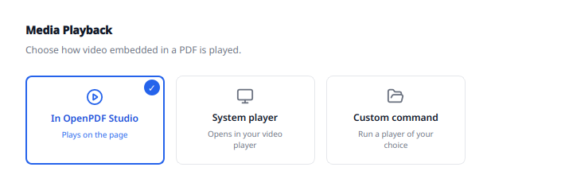

# Rich media

[README](../../README.md) · [Developer documentation](../../README.md#developer-documentation)

Media embedded in PDFs as `/Screen`, `/RichMedia` and `/Movie` annotations:
finding it, playing it, and putting new media into a document.

```
SPDX-License-Identifier: LicenseRef-OpenPDF-Business
```

This module is **source-available, not open source**. It is free for personal
use; business use needs a Business License after a 30-day evaluation. The full
terms are in the [module license](../../modules/rich-media/LICENSE) (identical to
[OPENPDF-BUSINESS.txt](../../LICENSES/OPENPDF-BUSINESS.txt)). The Core is
dual-licensed GPL-3.0-only or Commercial; see the repository [LICENSE](../../LICENSE)
and [licensing map](../../LICENSES/README.md).

## Status

The module is built. It finds media in a PDF, plays it, and embeds new media
into one.


*`RichMediaPanel` supplies the options for insertion and edits of the selected
medium; `MediaLayer` applies them to the document overlay.*

```
modules/rich-media/
  MediaModule.cpp          the only place that registers with the Core
  engine/
    MediaAsset.hpp         a find: page, rect, name, MIME, object number
    MediaScanner.*         qpdf: /RichMedia, /Screen + Rendition, /Movie
    MediaExtractor.*       the bytes onto disk, on click rather than on open
    MediaSpec.hpp          an insert: source, poster, trigger, playback, place
    MediaSession.*         what is inserted or dropped but not yet saved
    MediaFormat.*          container and codec, read out of the file itself
    MediaConvert.*         rewrite as H.264 in MP4: system encoder, then ffmpeg
    SystemEncoder.*        Media Foundation's H.264 and AAC encoders on Windows
    MediaDrop.*            place a dropped video on a page or on its own page
    RichMediaWriter.*      qpdf: annotation, filespec, EF stream, /AP poster
    PosterFrame.*          still frame via VideoStill, drawn placeholder otherwise
    VideoStill*.cpp        one frame out of a video, per platform
    ExternalPlayer.*       hand-off to vlc/mpv/system, with a cleaned env
  ui/
    MediaLayer.*           the PageOverlay: finds, places, plays, writes
    MediaFrame.*           what sits over a medium on the page
    MediaPlayerFrame.*     the player on the page, above a PlayerEngine
    *PlayerEngine.cpp      what decodes: Qt Multimedia, or Windows' own
    RichMediaPanel.*       options of the selected medium and the next insert
    ConvertCard.*          the ffmpeg card on Settings > Add-on Packages
```

`HAVE_RICH_MEDIA` gates the whole directory and requires qpdf, plus Qt
Multimedia everywhere except Windows, which brings its own decoders. Neither is
optional, and that is the point: a build missing one of them used to succeed
and then behave differently from every other build, with settings that quietly
did nothing. The module is skipped with a warning when a dependency is missing;
configure names the package to install (`qt6-qtmultimedia-devel`). The Windows build
links `mfuuid` and `strmiids` and loads `mfplat`, `mfplay` and `mfreadwrite`
at runtime, all part of the system, so a Windows N without the Media Feature
Pack still starts.

Everything the module does works the same on every platform it builds on:

| what | how | needs |
| --- | --- | --- |
| playback | Qt Multimedia, or DirectShow and MFPlay on Windows | see above |
| poster | one frame through the same decoder that plays | see above |
| format check | the container and codec read out of the file | nothing |
| reading, writing | qpdf | qpdf |
| conversion to H.264 | Media Foundation on Windows, ffmpeg as fallback and on Linux | ffmpeg on Linux, with libx264 or OpenH264; shipped in the Windows packages |

On Windows the conversion uses the H.264 and AAC encoders Windows ships
(`SystemEncoder`: Source Reader into Sink Writer, NV12, High profile, AAC
160 kbit/s). Microsoft licenses those codecs; nothing is shipped for it.
`moov` stays after `mdat`: asked to put it first, the MP4 sink either refuses
to finish or writes a file whose sample offsets point nowhere. WebM and MKV
report half their frame rate to Media Foundation, so the rate is taken from
the frame durations; given the reported one, the video processor drops every
other frame. ffmpeg stays the fallback: when the system encoder fails or is
missing (Windows N), and first when an H.264 stream only needs a new container,
because ffmpeg repackages it without encoding it again. On Linux ffmpeg is the
only way, as before. It encodes with libx264 where it has it and otherwise
with OpenH264, the only H.264 encoder in Fedora's own ffmpeg; `MediaConvert`
asks `ffmpeg -encoders` once per binary. ffmpeg is looked up on every use, so
one installed from Settings > Add-on Packages (`ConvertCard`) counts at once,
and the warning without it leads there. On Windows only the shipped
`ffmpeg.exe` and the one downloaded on that page are used, never one on
`PATH`, so a removed ffmpeg stays unused.

The Windows packages ship their own `ffmpeg.exe` next to the program
(`packaging/windows/build-ffmpeg-mingw.sh`), for what Media Foundation cannot
read: AC3 sound, which this Windows does not decode at all, and AV1, which it
decodes only with a graphics adapter and otherwise hands out as empty frames;
`SystemEncoder` treats an empty frame as failure. It is an LGPL build without
x264, with dav1d for AV1; on Windows `MediaConvert` has it encode
through Windows' own H.264 encoder (`h264_mf`) and ffmpeg's AAC encoder. The
shipped one is the only one besides a downloaded copy of the same build. It behaves identically everywhere: with an encoder the
offer appears, without one the user is told what the consequence is. Reading a file's format used to ask ffprobe and no longer does:
`MediaFormat` walks the ISO base media boxes far enough to name the container
and the codec, which is exactly the question being asked.

Written on insert matches, object by object, a RichMedia document made by a
widely used PDF editor:

```
/Annot /RichMedia  /F 68  /NM (RM1)  /BS << /S /S /W 0 >>  /Border [0 0 0]
  /AP << /N <form xobject: poster, letterboxed, /DCTDecode image> >>
  /RichMediaContent  << /Assets <ref> /Configurations <ref> >>     (no /Type)
      /Assets         << /Names [ (clip.mp4) <filespec> ] >>
      /Configurations [ << /Subtype /Video /Instances <ref> >> ]   (no /Type)
          /Instances  [ << /Asset <filespec> /Params <ref> >> ]    (no /Type)
              /Params << /Binding /Background /FlashVars (source=…) >>
  /RichMediaSettings /Activation << /Condition /XA
                                    /Configuration <ref>
                                    /Presentation << /Style /Embedded … >> >>
```

Two places where we deliberately differ from that editor: it writes a `skin=…swf`
into `/FlashVars` that it resolves from its own installation and does not embed,
and it puts the file into `/EF` under both `/F` and `/UF`. The first is a
promise nobody here can keep; the second is redundant.

The `/AP` appearance stream is not decoration. PDFium draws it, and so does
every other viewer. Without it the place a video sits is a white hole in
anything that cannot play the video.

**Format.** A PDF may embed any file, but it is only played where a viewer
knows the format, and the common denominator is H.264 in an MP4 container:
that plays in the PDF viewers that play media at all, and in browsers and on
phones besides. Anything else is caught by `MediaFormat` before it is embedded,
and the user is offered a conversion (`libx264`, `yuv420p`, `+faststart`; a
stream that is already H.264 is only repackaged; on Windows Media Foundation
encodes the same thing). The question put to the user
is about reach, not about one product: naming a single viewer would be both
narrower and less true. Without an encoder the user is told what will happen
and can embed anyway.

Two rules the code keeps:

- Only embedded assets are played. A `/Movie` or `/Screen` annotation pointing
  at a path or an address outside the document is shown and refused. A viewer
  that follows addresses out of a stranger's document betrays its reader.
- Nothing starts by itself. `/RichMediaSettings /Activation /Condition` is
  written as `/XA` (on click) unless the user asks for `/PO`, and the reading
  side never auto-plays.

**Inserting** works like the image tool: drag a frame on the page and the
file dialog opens; the new medium takes the panel's options and is selected.
*Replace media* in the context menu swaps the file and keeps the options.

**Dropping a video onto an existing page** inserts a resizable medium centred
at the drop position. Its native aspect ratio is kept and its initial size is
limited to 42 percent of the page width and 35 percent of its height, leaving
room to move and enlarge it. A drop between pages still gives the video a page
of its own, using its dimensions at 150 dpi with the longest side held between
288 and 420 pt.

A page cannot be a session change, so this writes a working copy and hands it
to the view, the same route the page organizer takes, and the user's file
stays untouched until they save.

**Opening a video** with File > Open makes a new document of one page in the
video's proportions, the same page a drop between pages gives it
(`MediaDrop::newDocument`). The module adds videos to the open dialog through
`Importing::addFormat()`; the conversion runs on the GUI thread, because it
may ask the same question as inserting does, and the result opens as an
unnamed working copy like an imported Word file.

Both the drag and the drop ask the overlays. That is not redundancy: a file
turned away when it enters the view never reaches the drop handler at all, and
an MP4 was refused with a no-entry cursor until `dragEnterEvent` learned to ask
as well.

**Playing in OpenPDF Studio means only that.** When the setting says so, the
file is never handed to a player outside this program, not even when the
built-in one fails: the user decided where their media may be opened, and
starting a foreign process against that decision is worse than not playing.
The other two settings are the user asking for an outside player, and there it
is allowed.



*The playback setting is the user's choice of destination. Keep that choice
consistent across extraction, playback and failure handling.*

Playback starts with a question. A document that is merely open must not be
able to start a decoder (let alone a player process outside this program) on
a single click, so the first playback in a document asks: trust this document,
or do not play. The careful answer is the preset one, and trust
lasts for the session and covers exactly that document. Media the user has just
inserted is exempt; they picked the file a moment ago.

**Two engines, chosen at compile time.** `PlayerEngine::create()` returns Qt
Multimedia everywhere and a Windows engine on Windows. The frame above them is
the same: transport bar, poster, geometry. An engine that hands over pictures
is painted here; one that draws into a window of its own is only told where.
A click on the timeline or the volume slider jumps there instead of stepping;
the volume slider hides when the frame is narrower than 360 pixels.

Windows needs its own because the only backend packaged for MinGW is
`windowsmediaplugin`, which builds a Media Foundation session with an EVR
presenter and answers "Media session serious error" for files the same machine
plays elsewhere without trouble. What the Windows engine uses instead is what
the system has had all along: DirectShow and
MFPlay, both part of every Windows, needing no DLL we ship. Each draws into a
window that Windows clips to the player widget, so scrolling behaves. Grabbing
a still follows the same split (`VideoStill`), or the poster of a video that
plays perfectly well would come out as a drawn placeholder.

**Which of the two, and in which order.** DirectShow is asked first, and not
because it is the better engine. It is the cheaper question: it answers in
milliseconds for anything it cannot open, and it leaves Media Foundation
untouched. MP4 is what it declines on Windows, since no MP4 splitter ships with
the system, and that is the moment MFPlay is started and takes over. A graph
that renders only part of a file counts as no graph, because sound without a
picture looks like playback and hides the road that would have shown the video.

Media Foundation is started on that first use and not at construction. It loads
a decoding stack on startup, and where that stack is broken it takes the
process down before a file has even been named, which is exactly what Wine
does, where the same MP4 then plays through DirectShow without a complaint.

The Qt engine hands frames over instead of using a `QVideoWidget`. Two bugs
hung on that widget: the first playback stayed black because its output surface
did not exist yet when the first frame arrived, and scrolling pushed the
picture over the toolbar because it may take a native window that knows nothing
about the scroll area's clip. Converting once per frame and scaling lazily
while painting keeps the cost off the paint path.

When an engine does give up, the dialog names what the file actually is and
offers two ways on that the user picks: a 1080p copy, made the same way as a
conversion and played in the program, or the system player. The copy exists only for playback;
the document keeps the original, and a medium that needed one is played from it
from then on. A copyable block underneath carries version, error, file and
which backends are present, so a report says something.

**Removing.** With the Rich Media tool active a click selects a medium instead
of playing it; `Delete` and the context menu remove it. A medium that is
already in the document cannot disappear before the next save, so its frame
switches to covering the spot in the page's own colour, sampled from the
rendered page around it: the same approach the Core uses for text that has
been deleted but not yet written out.

The selected frame's eight handles resize it, and dragging its body moves it.
While an existing medium is selected, its page appearance scales with the
frame on a transparent editing layer. Moving or resizing therefore never
covers the PDF page with a synthetic background. Posters fill their frame by
cropping excess image area instead of adding dark bars.

Media changes, including removal, use `MediaLayer::noteChanged()` and
`PageOverlay::reportChange()` to enter the document history. `state()` and
`restoreState()` carry the media session through undo, redo and recovery.

### Not built yet

- Presentation mode plays nothing; the poster is what the projector shows.
- The export dialog has no "keep or drop media" option.

## What belongs here

Anything whose only purpose is media playback: extracting the embedded stream,
the player surface drawn over the page, transport controls, the handoff to an
external player, and the module's own settings.

## What does not belong here

- Anything the Core needs in order to open, render, edit or save a document.
  If removing this directory breaks the viewer, the boundary was drawn wrong.
- Core types and helpers stay in `src/`; this module may include them, not the
  other way round. The Core must build and run with `modules/` absent.

## When code lands here

1. Give every file the SPDX header:
   `// SPDX-License-Identifier: LicenseRef-OpenPDF-Business`
2. Add `modules/rich-media/CMakeLists.txt` with its own
   `target_sources(OpenPDFStudio PRIVATE ...)`, as every source folder has,
   plus `add_subdirectory(modules/rich-media)` in the root `CMakeLists.txt`,
   guarded so a checkout without this directory still configures.
3. Keep it behind a `HAVE_RICH_MEDIA` define, so the Core-only build stays a
   build that actually gets exercised.
4. The backend rule this used to carry is spent: Poppler and Qt6::Pdf are both
   gone, PDFium is the only engine and is BSD-licensed, so combining this
   module with the Core raises no engine question. See the [licensing map](../../LICENSES/README.md).

## Where a Business License key comes from

The key is deployment data, not a gate. Section 6 of the license is explicit:
the notice is a reminder, and the module must not stop working, withhold
features or make itself unusable when a check fails or is absent. Personal Use
never needs a key at all (section 2: no registration, no activation).

The setup asks once which kind of use this is (one page, "Personal" preselected)
and records the answer as `HKLM\Software\OpenPDFStudio\Usage` =
`personal` | `business`. The application's stored usage overrides the installer's;
`OPENPDF_USAGE` overrides both for testing. With
`personal` there is no notice, no countdown and no key prompt, ever. It decides
nothing else; both answers install and run the identical program.

Only the Windows setup can ask at install time. An RPM, a DEB or an AppImage
has nobody to ask, so the application does it itself on first start (same
question, same two answers, personal preselected) and stores it as
`[license] usage` in `config.ini`. That value also outranks the installer's,
because a declaration that cannot be corrected is worse than none. Correcting it
means editing that one line: it is deliberately not in the settings dialog,
where it would read as a switch that unlocks something.

The key itself is held in two places, machine before user:

| Scope | Windows | Set by |
| --- | --- | --- |
| machine | `HKLM\Software\OpenPDFStudio\BusinessLicense`, values `Key`, `Source`, `SetAt` | the installer's business-use key field or `Setup.exe /S /KEY=…` |
| user | `config.ini`, `[license] businessKey` | the *License Key* settings page |

A machine key wins over a user key, so a site license covers every account on
the machine without anyone typing anything. `Usage` outranks both: a personal
declaration silences the reminder even if some key is present. The installer writes
the key when one is supplied and never validates it: checking belongs to the
module, not to the setup. Uninstalling removes the machine key with the rest of
`HKLM\Software\OpenPDFStudio`.

### Personal and business installations

The installer asks for the usage declaration, with Personal preselected. Its
key field is shown for Business use. A silent installation skips that page
and selects Business when `/KEY=` supplies a key, otherwise Personal. Both
install the same application features.

Personal usage suppresses the evaluation reminder and the License Key settings
page. For business usage, `MainWindow::showLicenseNotices()` checks the
evaluation on startup and opens the reminder when it is overdue and no valid
key is stored. Opening a media document is not required to trigger it.

The 30-day Evaluation Period cannot be derived from either place: it runs per
organisation from the first business use (section 1.5), not per installation.
Whatever the module records locally is an approximation for the reminder, not
the term itself.

### What exists today

`src/drm/` holds all of this: `LicenseStore` the state, `LicenseKey` the check,
`LicensePage` the settings page, `LicenseNotice` the two dialogs: the first
start's question and the expiry notice. Two things are computed: how many of
the 30 days are left, counted from the first start of a business installation
(`license/evaluationStart`), and whether the stored key is valid. Once the days
are up and no valid key is stored, the application shows the notice at every
start and otherwise carries on unchanged. The notice asks for a key,
it does not withhold anything, and no part of the program consults the result. The page is built only
where `Usage` is `business`. A personal installation has no License Key entry
in its settings at all. Switching between the two means editing
`[license] usage`, and the 30 days are not restarted by switching back and
forth: `[license] evaluationStart` is written once and never rewritten. `OPENPDF_USAGE=business|personal` overrides all of it
for tests and screenshots (`--shot-settings`, `--shot-license-notice`), which
report the state they find rather than declaring one.

### The key

A key is `OPDF1-` and the Base32 of a 13-byte header, the licensee's name and
an Ed25519 signature over `OPDF-LIC-1`, header and name. Little-endian:

| bytes | field |
| --- | --- |
| 0 | format version, 1 |
| 1 | product, 1 = Rich Media |
| 2-5 | serial |
| 6-7 | seats |
| 8-9 | issued, days since 2025-01-01 |
| 10-11 | expires, same count, 0 = never |
| 12 | length of the name in UTF-8 bytes |

`License::inspectKey()` checks the signature against the public key in
`LicenseKey.cpp` (Monocypher, `src/3rdparty/monocypher/`) and reports Valid,
Malformed, BadSignature, WrongProduct or Expired; dashes, spaces and case do not
matter. The settings page refuses a key that is not valid. A stored key that
does not pass, an expired one or one set by the installer, is shown as such and
counts as none. Seats are carried, not enforced. The name stays empty: the
script notes the licensee only in its log, and the page shows no name.

Keys are issued by a script that lives next to the private key, outside the
repository. It signs through `openssl`, refuses a key inside a git work tree and
keeps the key and its log of issued keys readable only by their owner. Neither
belongs in a repository: whoever holds the private key can issue keys for every
released build.
