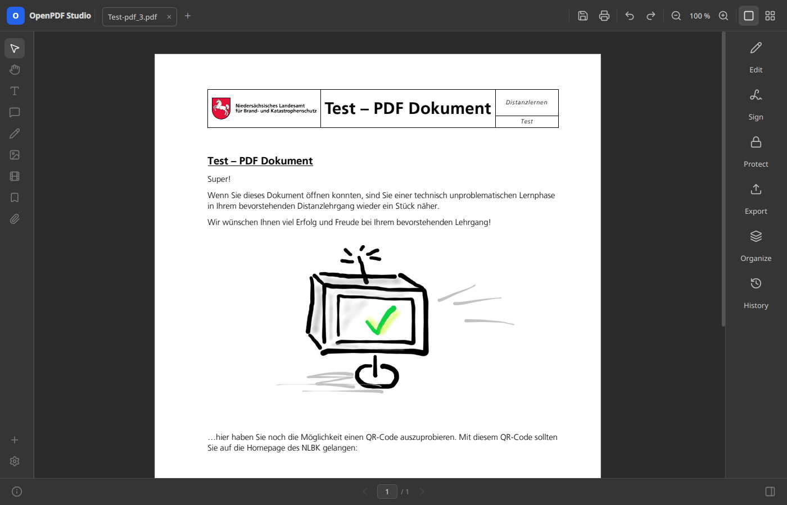

# Testing

[README](../../README.md) · [Developer documentation](../../README.md#developer-documentation)

The executable provides headless export, import, editing and screenshot modes.
They use the same engine and views as the application.

## Prepare a local check

[Build the application](building.md) and run commands from the repository root.
In a dedicated Linux shell, create a temporary test directory, isolate settings
and run Qt without a display:

```bash
export OPENPDF_TEST_DIR="$(mktemp -d)"
export QT_QPA_PLATFORM=offscreen
export OPENPDF_CONFIG="$OPENPDF_TEST_DIR/config.ini"
export XDG_DATA_HOME="$OPENPDF_TEST_DIR/data"
```

Place a non-sensitive `input.pdf` in `$OPENPDF_TEST_DIR` before running the
export examples. The offscreen Qt platform plugin must be installed. These
exports apply to the current shell. Document and screenshot modes still use
`QApplication`, even without a visible window.

## Export and import commands

```text
build/OpenPDFStudio --export-pdf    in.pdf out.pdf [pages=1,3-4] [nocomments] [noforms]
                                    [nofonts] [nocompress] [q=60] [pw=…] [srcpw=…]
build/OpenPDFStudio --export-docx   in.pdf out.docx [pages=1,3-4] [q=60] [nocompress] [srcpw=…]
build/OpenPDFStudio --export-images in.pdf out.png [pages=1,3-4] [q=85] [srcpw=…]
build/OpenPDFStudio --import-pdf    in.docx out.pdf [dump=text.txt]
```

Brackets denote optional arguments. `pages=` uses page numbers starting at 1.
`srcpw=` provides the input PDF password; PDF export's `pw=` sets an output
opening password. Use synthetic passwords in tests, since command arguments
can appear in process listings and shell history.

`--import-pdf` accepts `.docx`, `.odt` or an image. `dump=` writes parsed plain
text before layout, separating parsing faults from PDF layout faults.

For example:

```bash
build/OpenPDFStudio --export-pdf "$OPENPDF_TEST_DIR/input.pdf" "$OPENPDF_TEST_DIR/export.pdf" pages=1
build/OpenPDFStudio --export-docx "$OPENPDF_TEST_DIR/input.pdf" "$OPENPDF_TEST_DIR/export.docx" pages=1
build/OpenPDFStudio --export-images "$OPENPDF_TEST_DIR/input.pdf" "$OPENPDF_TEST_DIR/page.png" pages=1
```

Check page count and text, and open the output in another viewer. Image export
creates a file per page. DOCX needs a visual check in a word processor in
addition to checking its text.

## Selection, editing and organizer commands

```text
build/OpenPDFStudio --select-text   in.pdf [page=1] [from=x,y] [to=x,y] [srcpw=…]
build/OpenPDFStudio --apply-edit    in.pdf out.pdf at=x,y text=… [page=1] [preview=out.png] [srcpw=…]
build/OpenPDFStudio --apply-edit    in.pdf out.pdf field=Name text=Value [page=1] [srcpw=…]
build/OpenPDFStudio --organize-save in.pdf out.pdf
```

Coordinates are PDF points from the displayed page's top-left, as reported
by `--select-text`. Quote arguments containing spaces, such as
`"text=Replacement text"`. Use a known text location for `at=` and compare the
preview, saved rendering, extracted text and unaffected areas. The `field=`
mode is a test entry point, not a complete user-facing form editor.

`--organize-save` exercises the organizer's save path. For page manipulation,
also check reorder, rotation, deletion, insertion and merging through the UI.

Commands normally return `0` on success and `3` when an operation fails.
Selection and edit commands use `2` for opening failures; selection can return
`1` for an empty result, and editing returns `4` when no text is found at the
requested position. Use valid arguments: an unknown command or too few
arguments falls through to ordinary application startup.

## Screenshot commands

```text
build/OpenPDFStudio --shot-window          out.png in.pdf [dark] [edit=x,y]
build/OpenPDFStudio --shot-organizer       out.png in.pdf [dark]
build/OpenPDFStudio --shot-presentation    out.png in.pdf [page=N]
build/OpenPDFStudio --shot-export-dialog   out.png [word|image] [empty] [dark|light]
build/OpenPDFStudio --shot-history-dialog  out.png [dark]
build/OpenPDFStudio --shot-settings        out.png ["License Key"] [dark|light]
build/OpenPDFStudio --shot-license-notice  out.png [dark|light]
```

Inspect the generated images for clipping, spacing and both themes.
The implementation in [src/cli/ShotWindow.cpp](../../src/cli/ShotWindow.cpp)
has further interaction options for focused regression checks.



*Example output from `--shot-window` with `dark`. Compare text, icons and page
alignment with the [light-theme reference](../images/screenshots/overview.png).*

`OPENPDF_USAGE=business|personal` overrides recorded usage for license-related
tests and screenshots. These modes report the state they find; the license
notice shot only succeeds when an expiry reminder is actually due, and the
License Key settings page exists only for business use. Keep synthetic license
state in the isolated test configuration.

## Layer boundary checks

Each search below should produce no matches:

```bash
rg -n '#include "ui/' src/engine src/app
rg -n '#include "engine/' src/app
rg -n 'QWidget|QDialog' src/engine
rg -n '#include "rich-media/' src
```

Before placing a widget in `ui/widgets/`, check that it has more than one
owner outside that folder. For example:

```bash
rg -l '\bIconButton\b' src -g '*.cpp' | rg -v '^src/ui/widgets/'
```

## Choose checks for the change

Build after code changes and exercise the relevant paths. Optional dependency
guards must still compile without those libraries; confirm configuration output
and generated definitions rather than assuming a feature was disabled. qpdf
has both CMake and native pkg-config discovery, so disabling only its CMake
package may still find it through pkg-config.

For module work, include a Core-only build using `-DOPENPDF_RICH_MEDIA=OFF`.
For saving or history work, also verify undo, redo, reopen and recovery with
unsaved changes. For signing, check existing signatures before and after the
operation. Record the performed checks and limitations in the change description.
