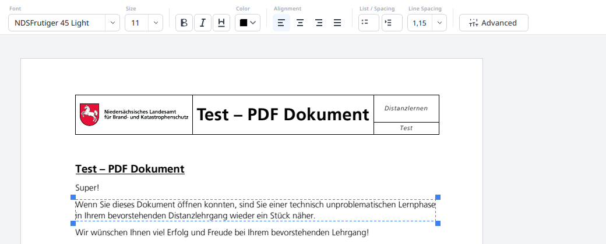
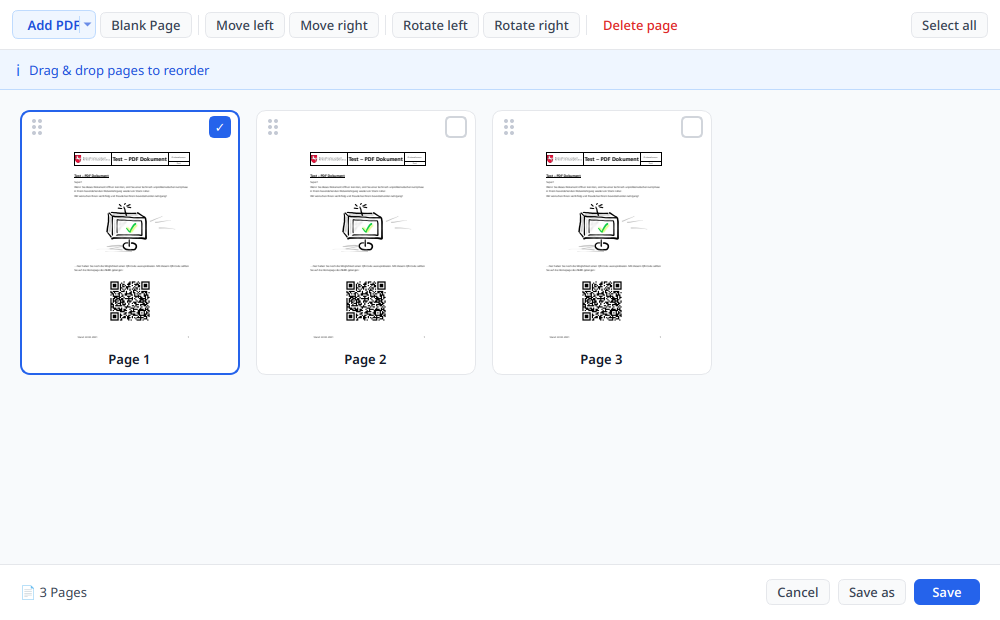
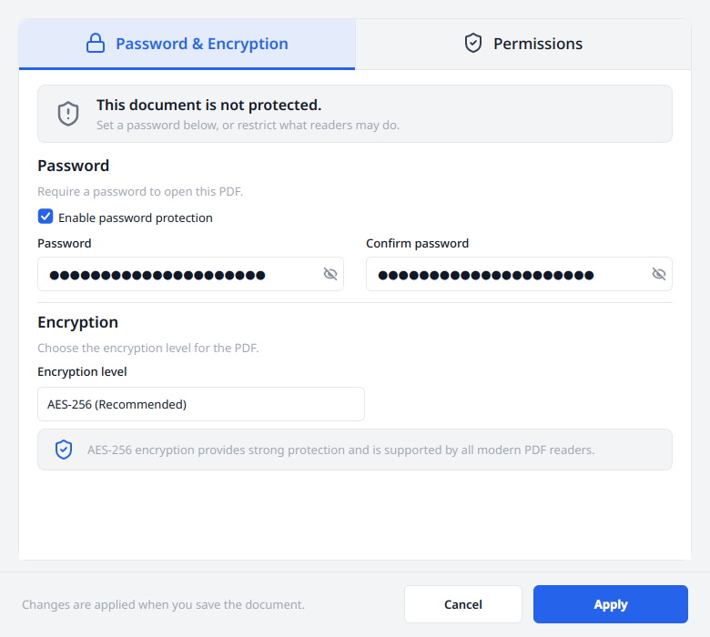
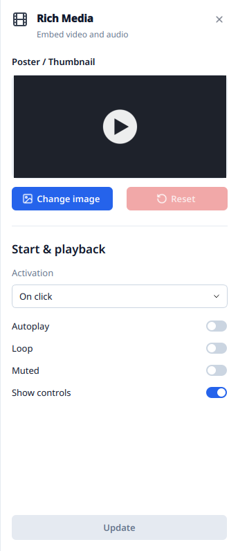

# Editing

[README](../../README.md) · [User documentation](../../README.md#user-documentation)

Enable **Edit Mode** before changing existing page content. The file you opened
stays untouched until you save. Use `Ctrl+S` to save, `Ctrl+Shift+S` to choose
another name, and undo, redo or **History** to review your changes.

Every opened document starts without Edit Mode. To open documents ready for
editing, clear **Open new documents in reading mode** under Settings →
**Security**.

## Existing text and new text

With the **Text** tool, click a text run and type into the inline editor.
Text is written back as vector content. Characters retain the original font,
size, colour and style where possible; characters the font cannot encode use
a fallback font. Use the format bar and text properties to adjust formatting.
With part of the text selected, font, size, bold, italic, underline and colour
change only that part.

*The open text block has a blue frame. Its formatting controls appear above the page.*

If automatic paragraph detection selects the wrong area, hold Shift and drag
a frame around the characters you want to change. This can select part of a
text run. To add text, drag a new box with the Text tool and type into it.
The **Select** tool selects text for copying; hover highlighting indicates
editable content.

PDFs contain positioned page content, so editing does not provide Word-style
reflow of an entire document. A notice appears when an edit cannot match the
page exactly. qpdf is needed to preserve original page content during text saves.

## Scans and OCR

When a page has no usable text, the editor falls back to OCR if Tesseract is
included in the build. It recognizes text from the scan and replaces the
selected area with editable text. Recognition and font matching are approximate;
check characters, line breaks and background after saving. All installed
languages of the 12 that Settings → **Add-on Packages** offers are used; a
language added there counts at the next click. Without any, a notice leads to
that page.

## Images, drawings, notes and links

| Tool | Actions |
| --- | --- |
| Image | Insert an image; move, scale, rotate, replace, copy, paste or delete an existing page image |
| Draw | Use pen, highlighter and eraser with adjustable colour and width; strokes save as vector paths |
| Notes | Place a page comment and manage comments in the notes panel |
| Link | Select text, click Link, enter the address and choose Set Link; edit or remove existing links by right-clicking them |
| Bookmark | Navigate the outline; add the current page, rename, remove and reorder bookmarks |

Existing images are changed in place, preserving their ordering relative to
text. Bookmark changes require qpdf.

## Organize pages

Open the page organizer to reorder pages by drag and drop, rotate or delete
pages, insert blank pages, or merge another PDF. It also works with encrypted
documents after their passwords are supplied. Page operations use a session
working file; saving commits them to the chosen destination. Vector organizer
output requires qpdf.

*Select a page to enable its actions, or drag its dotted handle to reorder it.
This example repeats the test page three times.*

## Passwords and permissions

The protection dialog sets or removes an opening password and permissions for
printing, editing content, copying, comments, forms, page assembly and
accessibility, with a separate permissions password. AES-256, AES-128 and RC4
are available. Protection changes require qpdf and take effect on save.

OpenPDF Studio follows the permissions of a restricted PDF itself. A refused
action asks for the permissions password; once entered, the document is
unrestricted until it is closed. Without high-quality printing, pages print at
150 dpi. Settings > Security > Follow document permissions turns this off.

*Enable password protection and confirm the password. The Permissions tab controls
reader restrictions; Apply stages the change for the next save.*

Passwords are held in memory and are not stored in recovery history. After a
crash, a pending protection change returns as unprotected; set it again before
saving. Opening an already encrypted PDF may require entering its password again.

## Opening Word, OpenDocument and images

`.docx` and `.odt` are read directly and converted into PDF without an external
office application or uploading the file. Paragraph and character formatting,
headings, lists, tables with borders and shading, embedded pictures, page size,
margins and fixed boxes are supported. Both formats require zlib in the build.

Headers, footers, footnotes, fields such as page numbers and tables of contents,
multi-column layout and tracked changes are omitted. Reflow and fixed box
positions can differ from Word. Legacy `.doc`, `.rtf`, `.xlsx` and `.pptx`
are not supported.

JPEG, PNG, GIF, BMP, TIFF and WebP open as image pages. JPEG bytes are embedded
without another lossy encode; other formats retain their pixels. TIFF and
WebP depend on the available Qt image format plugins. All converted documents
open as unnamed PDF working copies, leaving the source unchanged.

## Rich media

The separately licensed Rich Media module plays embedded video in the page
and inserts new video with a poster. Choose **Rich Media**, drag a frame and
pick the file. Dropping video onto a page places it there; dropping between
pages creates a page for it, and opening a video with **Open** (Ctrl+O) makes
a new document of that one page. Select a medium with the tool to move it, resize
it with its handles, replace it through the context menu, or delete it.
Media changes participate in undo, history and recovery.

*The Rich Media tool opens this panel. Its options apply to the next insertion;
Update applies changed options to a selected medium.*

The first playback of existing media asks for permission, with trust limited to
that document and session. Only embedded assets play; media pointing to an
external path or URL is refused. Settings chooses in-app or external playback;
an in-app failure does not silently launch another player.

H.264 in MP4 is the intended insertion format. Other codecs prompt for a
conversion when an encoder is available: Windows uses its system encoders with
ffmpeg as fallback, and Linux uses ffmpeg. Settings → **Add-on Packages** adds
or removes ffmpeg. A playback failure may offer a 1080p
playback copy or an external player; the document retains the original asset.
Presentation mode currently displays only the poster, and export has no switch
to keep or drop media. See [Licensing](licensing.md) for the module's terms.

## Current limits

A complete form editor and redaction are not implemented. Use the
[signature guide](signatures.md) for signing and the [export guide](export.md)
for output formats. If a tool is missing, check [Troubleshooting](troubleshooting.md).
