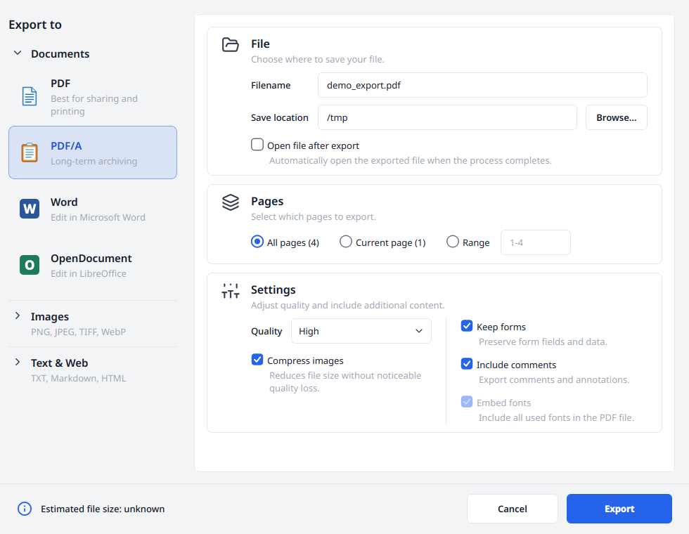
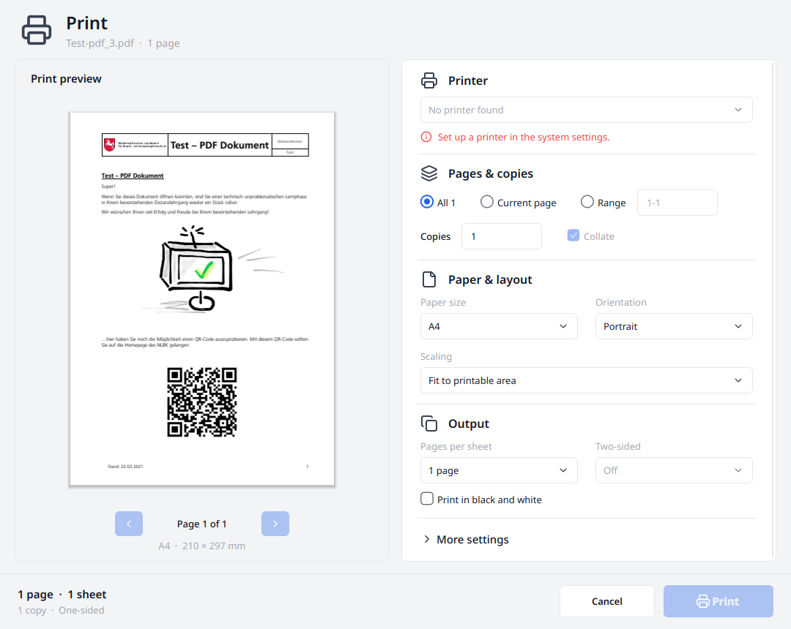

# Export and printing

[README](../../README.md) · [User documentation](../../README.md#user-documentation)

Export creates output from the current document, including unsaved changes.
Use **Save** to save the PDF you are working on, or the export dialog to choose
another format and output options.

## Export a document

1. Open **Export** and choose a format.
2. Enter a filename and save location.
3. Choose all pages, the current page or a range such as `1-3, 5, 8-10`.
4. Adjust the format's options and review the estimated output size.
5. Export, confirming replacement if output files already exist. Enable
   **Open file after export** if you want to open the result automatically.

The size shown before export is an estimate. Check the actual file and its
appearance before sharing it.

*Choose the format on the left, then the destination, pages and output options on the right.*

## Formats and options

| Format | Output and options |
| --- | --- |
| PDF | Page selection; include comments, keep form fields, embed fonts and compress images, with image quality control |
| Word (`.docx`) | Text, reconstructed layout and images, with image compression and quality control |
| OpenDocument (`.odt`) | The same as Word, for LibreOffice; each page keeps its own size |
| PNG | One lossless page image per selected page |
| JPEG | One page image per selected page, with quality control |
| TIFF | One lossless page image per selected page, for print and archiving |
| WebP | One page image per selected page, with quality control; **Maximum** is lossless |
| TXT | The text of the selected pages as UTF-8, without layout; a blank line separates pages |
| Markdown (`.md`) | Flowing text with headings, lists, tables, links, bold and italic; no pictures |
| HTML (`.html`) | The same as Markdown plus the pictures, embedded in one file; with image compression and quality control |
| PDF/A | PDF/A-2b for long-term archiving; the same options as PDF, fonts are always embedded |

PDF page selection and rewriting comments, forms, fonts or image compression
require qpdf. Without it, those PDF controls are disabled. Keeping existing
form fields during export does not provide a form editor.

PDF/A also requires qpdf. Fonts the document does not carry are embedded from
an installed font with the same character widths, such as Liberation Sans for
Helvetica or Arial. Scripts, media, hidden annotations and digital signatures
are removed, since PDF/A does not allow them; a message lists what changed.
The export stops with the reason when a document uses CMYK colours, a font
without a matching installed font, or the Symbol or ZapfDingbats fonts. Fonts
the document already embeds are checked too; one that lacks characters the
document shows, or whose widths do not match its program, stops the export.

Without **Compress images**, Word and OpenDocument keep pictures at their
original resolution as PNG and the quality setting is unavailable.

Word and OpenDocument output reconstruct a document from positioned PDF
content, so it may need adjustment in a word processor. Image exports turn the
page into pixels, including any visible signature appearance; they do not
carry PDF digital signature verification. Export has no dedicated option to
keep or remove embedded media.

For a single selected page, image export uses the chosen filename. Multiple
pages use names such as `document_page_1.png`. The quality setting also selects
the render resolution; PNG and TIFF remain lossless at the chosen resolution.

Markdown and HTML recognise headings by their size and lists by their
markers, and drop the page layout. TXT, Markdown and HTML take the text layer
of each page. Scanned pages without one have no text, since export does not
run OCR; HTML shows them as pictures.

Both link the web links of the PDF and web and mail addresses written in the
text, show coloured boxes as boxes (Markdown as quotes) and leave out running
heads and feet; only web and mail links are taken over. HTML keeps a drawing as
one picture with a chart's labels in it, Markdown gives a chart's labels line
by line.

## Print

Press `Ctrl+P` or choose **Print**. Review the page preview before sending
the job. Printing requires a build with Qt PrintSupport and a printer configured
in the operating system.

*The preview shows the chosen paper layout. In this example no system printer is
configured; add one in the operating system to enable Print.*

The print dialog offers page ranges, copies and collation, paper size,
orientation, fit to printable area, shrink oversized pages or actual size.
Choose 1, 2, 4, 6, 9 or 16 pages per sheet, or spread one page over 2, 4 or 9
sheets as a poster. Poster sheets overlap by 10 mm; cut marks are optional.
Two-sided printing depends on the printer's capabilities, and black-and-white
output is available.

Use **More settings → Print with the system dialog…** for driver-specific
options such as tray and print quality. Printing, like export, includes the
current unsaved document changes.

For command-line export and regression checks, see [Testing](../dev/testing.md).
For output failures, see [Troubleshooting](troubleshooting.md#saving-and-exporting).
