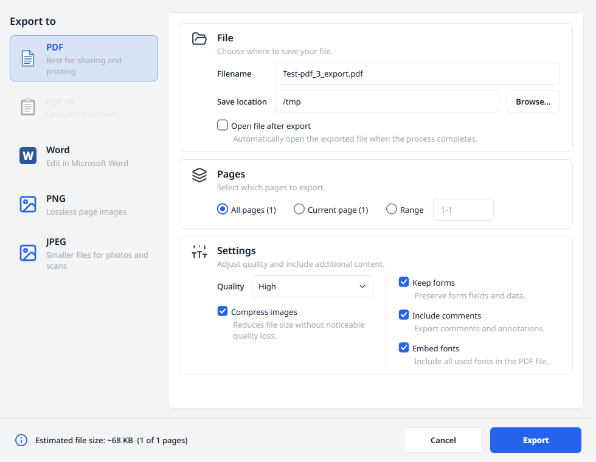
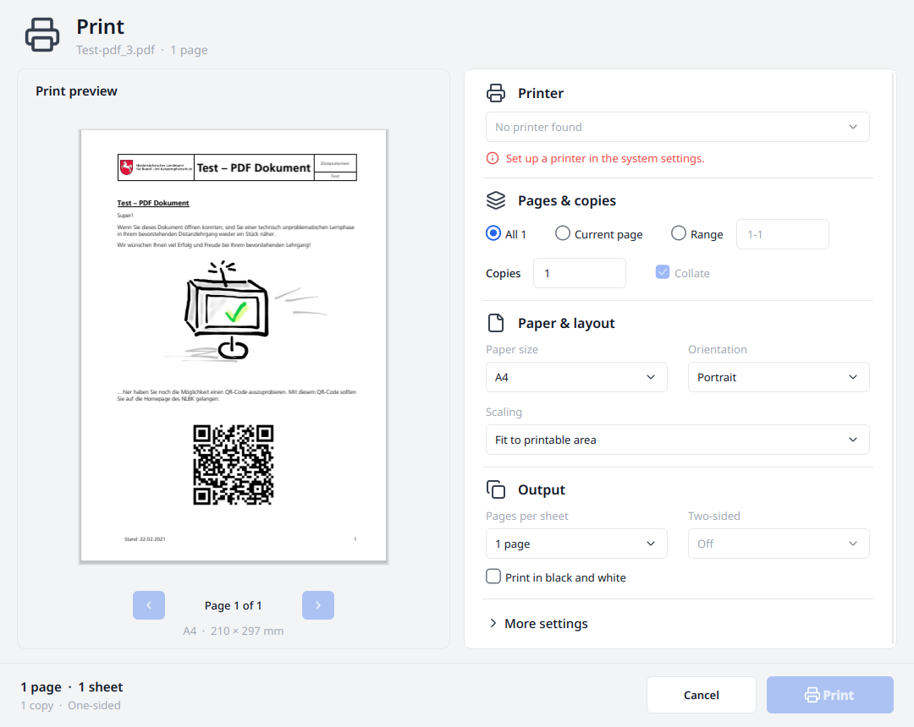

# Export and printing

[README](../../README.md) · [User documentation](../../README.md#user-documentation)

Export creates output from the current document, including unsaved changes.
Use **Save** to save the PDF you are working on, or the export dialog to choose
another format and output options.

## Export a document

1. Open **Export** and choose PDF, Word, PNG or JPEG.
2. Enter a filename and save location.
3. Choose all pages, the current page or a range such as `1-3, 5, 8-10`.
4. Adjust the format's options and review the estimated output size.
5. Export, confirming replacement if output files already exist. Enable
   **Open file after export** if you want to open the result automatically.

The size shown before export is an estimate. Check the actual file and its
appearance before sharing it.

*Choose the format on the left, then the destination, pages and output options on the right.*

## Formats and options

| Format | Output and options |
| --- | --- |
| PDF | Page selection; include comments, keep form fields, embed fonts and compress images, with image quality control |
| Word (`.docx`) | Text, reconstructed layout and images, with image compression and quality control |
| PNG | One lossless page image per selected page |
| JPEG | One page image per selected page, with quality control |
| PDF/A | Listed in the dialog but not implemented; the option is disabled |

PDF page selection and rewriting comments, forms, fonts or image compression
require qpdf. Without it, those PDF controls are disabled. Keeping existing
form fields during export does not provide a form editor.

Word output reconstructs a document from positioned PDF content, so it may
need adjustment in a word processor. Image exports turn the page into pixels,
including any visible signature appearance; they do not carry PDF digital
signature verification. Export has no dedicated option to keep or remove
embedded media.

For a single selected page, image export uses the chosen filename. Multiple
pages use names such as `document_page_1.png`. The quality setting also selects
the render resolution; PNG remains lossless at the chosen resolution.

## Print

Press `Ctrl+P` or choose **Print**. Review the page preview before sending
the job. Printing requires a build with Qt PrintSupport and a printer configured
in the operating system.

*The preview shows the chosen paper layout. In this example no system printer is
configured; add one in the operating system to enable Print.*

The print dialog offers page ranges, copies and collation, paper size,
orientation, fit to printable area, shrink oversized pages or actual size.
Choose 1, 2, 4, 6, 9 or 16 pages per sheet, or spread one page over 2, 4 or 9
sheets as a poster. Poster sheets overlap by 10 mm; cut marks are optional.
Two-sided printing depends on the printer's capabilities, and black-and-white
output is available.

Use **More settings → Print with the system dialog…** for driver-specific
options such as tray and print quality. Printing, like export, includes the
current unsaved document changes.

For command-line export and regression checks, see [Testing](../dev/testing.md).
For output failures, see [Troubleshooting](troubleshooting.md#saving-and-exporting).
