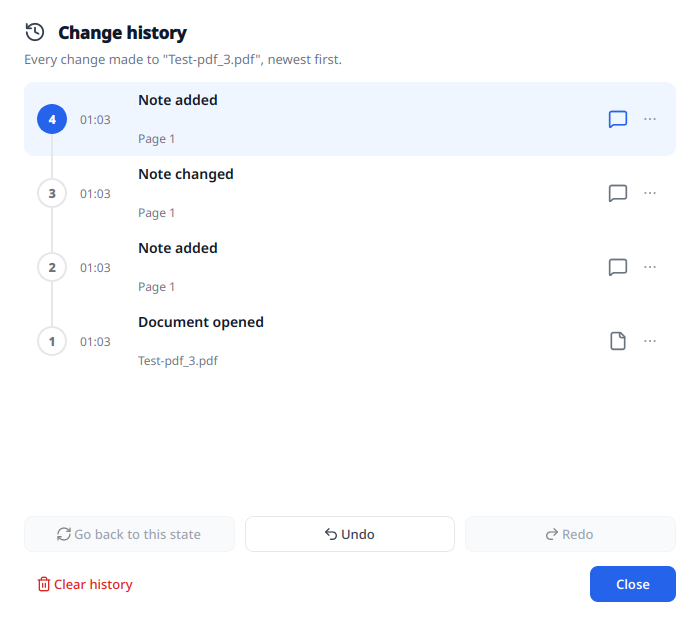
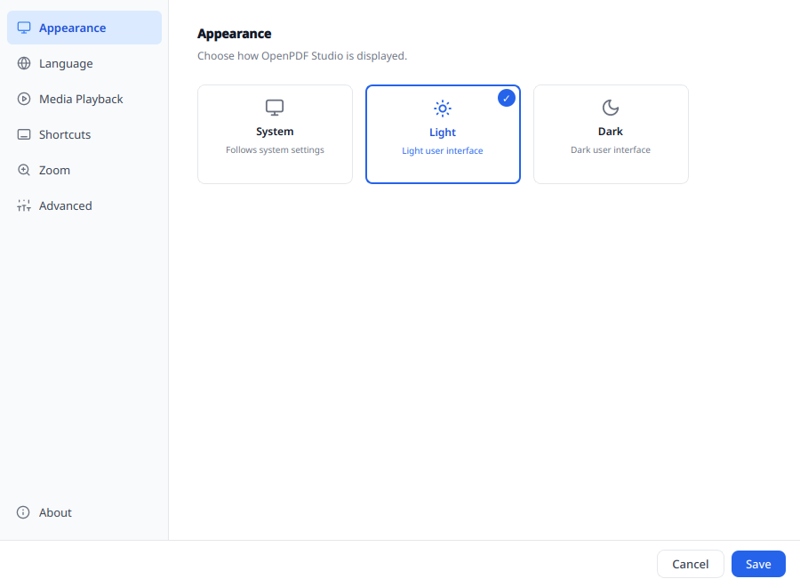

# Getting started

[README](../../README.md) · [User documentation](../../README.md#user-documentation)

OpenPDF Studio is a native desktop PDF viewer and editor for Linux and Windows.
Version 0.3.2 is an alpha. Saving replaces the original file, so keep a backup
of important PDFs and check edited text in a second viewer.

## Open a document

1. [Install OpenPDF Studio](installation.md) and start the application.
2. Choose **Open** (`Ctrl+O`) or drop a file onto the window. Each document gets
   its own tab, which you can drag to another position; `Ctrl+Shift+O` instead
   adds the file's pages to the end of the document in the current tab. Enter
   the opening password if the PDF requires one.
3. Read with the **Select** or **Pan** tool. Use the toolbar for single-page
   or grid view and the bookmark panel to jump through the document outline.

*Choose a page tool on the left or a document action on the right.
The example uses the [NLBK test PDF](https://www.nlbk.niedersachsen.de/download/164891/Test-pdf_3.pdf).*

You can also open `.docx`, `.odt`, JPEG, PNG, GIF, BMP, TIFF and WebP files.
They are converted locally in the background and open as unnamed PDF working
copies. Saving asks for a PDF filename; the original file is never rewritten.
Office import needs zlib, and some image formats need additional image plugins.
See [Editing](editing.md#opening-word-opendocument-and-images) for import limits.

## Find, zoom and present

- `Ctrl+F` opens the find bar. Enter and Shift+Enter move between matches;
  the hit counter shows your position.
- Use the zoom buttons, `Ctrl++`, `Ctrl+-` or Ctrl+mouse wheel to zoom.
  Wheel action, step size and zoom towards the pointer can be changed in Settings.
- `F5` starts presentation mode. Embedded video currently shows its poster
  there; playback is available in the document view.
- Open document information from the status bar to inspect file details,
  encryption, permissions, signatures, form fields, attachments and PDF/A status.
  The signature shield and encryption lock provide direct access to those details.

## Make and save a change

Enable **Edit Mode** to change existing content. Use the **Text** tool to edit
text or drag a new text box, **Notes** for comments, **Draw** for pen and
highlighter, and the page organizer for page operations. See [Editing](editing.md).

`Ctrl+S` saves the current document; `Ctrl+Shift+S` saves it under another name.
Edits and page changes use working copies until you save. Undo (`Ctrl+Z`),
redo (`Ctrl+Y`) and **History** let you review changes and restore earlier states.
After a crash, the next start offers recoverable documents and their history.

*History lists changes newest first. Select an earlier entry to return to that
state, or use Undo and Redo for individual steps.*

Use [Signatures](signatures.md) for signing and [Export](export.md) for other
formats and printing. Export includes unsaved document changes.

## Customize the application

Settings offers light and dark themes, keyboard shortcuts, zoom behavior and
language selection. Besides English, the interface is available in German,
French, Spanish, Italian, Portuguese, Dutch, Polish, Russian, Chinese,
Japanese and Korean. **Customize Tools** reorders or hides tools in the rail.

*Settings → Appearance selects the theme; the other settings pages are listed on the left.*

The search field above the page list (`Ctrl+F`) keeps only the pages that
contain the typed words, opens the first and marks the matching option; `Esc`
clears it.

Settings → **Advanced** can check for updates manually or at a chosen interval.
The check compares repository tags and links to the download page; it never
downloads or installs an update. Automatic checks can be switched off there.

Settings → **Security** decides whether clicking a link in a document asks
first, opens the browser right away or does nothing.

On first use, the installer or application asks whether usage is personal or
business. Personal is preselected. This relates to the separately licensed
Rich Media component; see [Licensing](licensing.md).

If a feature is missing or a document does not open correctly, see
[Troubleshooting](troubleshooting.md).
