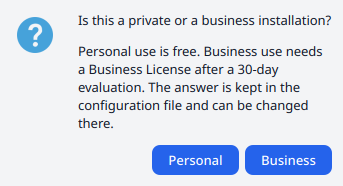
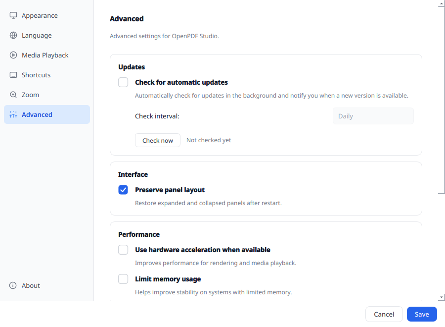

# Installation

[README](../../README.md) · [User documentation](../../README.md#user-documentation)

Packages are provided for Linux x86_64 and Windows x86_64. Download them from
[GitHub Releases](https://github.com/NuIIskill/OpenPDF-Studio/releases) or the
[download page](https://openpdf-studio.nullskill.de/download.html).
The examples below use version 0.3.2; use the filename of the package you downloaded.

## Linux packages

Install an RPM with your distribution's package manager. For Fedora:

```bash
sudo dnf install ./openpdf-studio-0.3.2-1.x86_64.rpm
```

For Debian or Ubuntu:

```bash
sudo apt install ./openpdf-studio_0.3.2_amd64.deb
```

The package manager resolves the declared runtime dependencies. Installing a
package built on another distribution still requires compatible library versions.

## Linux AppImage

Make the file executable and run it:

```bash
chmod +x OpenPDF_Studio-0.3.2-x86_64.AppImage
./OpenPDF_Studio-0.3.2-x86_64.AppImage
```

The AppImage bundles application libraries and Qt plugins. Its packaging removes
the X11/XCB platform plugin, so it requires a Wayland session and the host's
Wayland client libraries. See [Troubleshooting](troubleshooting.md#linux-startup-and-qt-platform-errors)
if it fails to start.

## Windows installer

Run `OpenPDF-Studio-0.3.2-Setup.exe` and follow the installer. The packaged build
includes PDFium, qpdf and Tesseract with German, English and French OCR data.
Windows media playback uses the system's DirectShow and Media Foundation
components; Windows N installations may need the Media Feature Pack for playback.

## Windows portable ZIP

Extract `OpenPDF-Studio-0.3.2-win64-portable.zip` into a writable folder and
start `OpenPDFStudio.exe` inside it. Keep the DLLs and subfolders alongside the
executable; copying only the executable leaves out its dependencies.

The ZIP includes a `config.ini` beside the executable. While that file exists
and is writable, settings are kept there. The installer uses settings in the
user profile instead. Portable mode changes where settings live; recovery
files still use the application's data directory.

## First start and updates

The installer or application asks whether usage is personal or business.
Personal use needs no key. Read [Licensing](licensing.md) for business use and
administrator deployment.



*On packages without an installer declaration, this question appears on first start.
Choose the usage that applies to your installation.*

On first start the application also asks whether it should open PDF files by
default, unless it already does. On Windows, the default-apps settings open
for the final choice.

Follow [Getting started](getting-started.md) to open your first document.
Update checks in Settings → **Advanced** link to a download; install the
replacement package yourself.



*Settings → Advanced offers Check now for a manual check. Enable automatic checks
to choose an interval; the example has them switched off.*

For a source build, use the separate [Building](../dev/building.md) guide.
